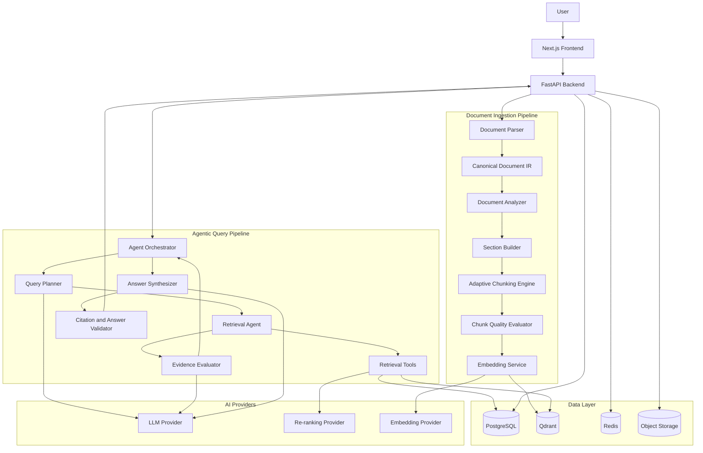
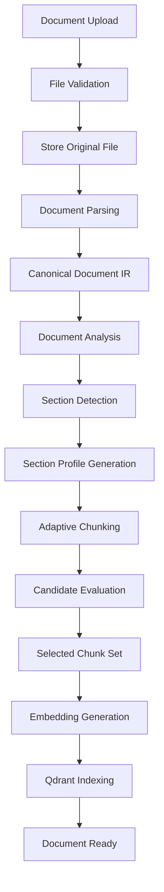
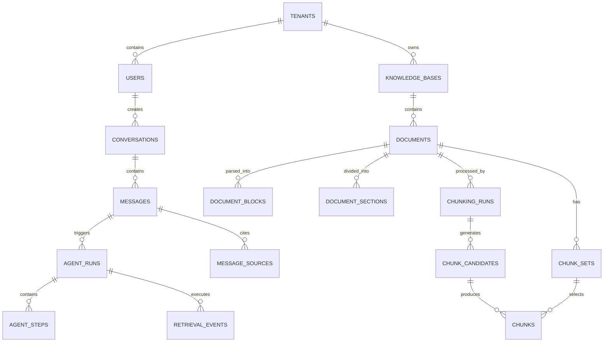
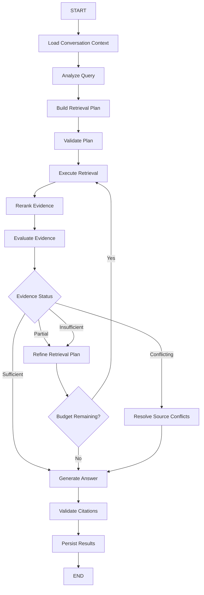

# Đề xuất Kỹ thuật
# Agentic RAG — Hệ thống Trí tuệ Tài liệu Thích ứng & Hỏi đáp

**Phiên bản:** 1.1  
**Ngày:** Tháng 11 năm 2026  
**Trạng thái:** Kiến trúc Đề xuất  
**Ngôn ngữ chính:** Python  
**Phong cách Kiến trúc:** Modular Monolith + Agentic Workflow  
**Ứng dụng mục tiêu:** Chatbot AI dựa trên Tài liệu  
**Nhật ký thay đổi:** v1.1 — bổ sung giải quyết ngữ cảnh hội thoại, đánh giá chất lượng tài liệu, đánh giá chunking theo tầng truy xuất, metadata quan hệ tài liệu và bảng snapshot phiên bản.

---

# 1. Tóm tắt Điều hành

## 1.1. Tổng quan Dự án

Hệ thống được đề xuất là một nền tảng Agentic Retrieval-Augmented Generation (Agentic RAG) có khả năng mở rộng, cho phép người dùng tải tài liệu lên, quản lý kho kiến thức xác định trước và tương tác với trợ lý AI có khả năng trả lời câu hỏi dựa trên tri thức sẵn có.

Khác với các hệ thống RAG truyền thống thực thi một pipeline truy xuất cố định, hệ thống này bổ sung một lớp điều phối agentic có thể chủ động quyết định cách truy xuất, đánh giá và tổng hợp thông tin.

Hệ thống được thiết kế để:

- Hiểu cấu trúc tài liệu và đặc điểm nội dung.
- Xử lý tài liệu một cách thích ứng bằng nhiều chiến lược chunking.
- Chọn chiến lược truy xuất phù hợp với câu hỏi của người dùng.
- Phân rã câu hỏi phức tạp thành các tác vụ truy xuất nhỏ hơn.
- Thực hiện truy xuất lặp khi bằng chứng ban đầu chưa đủ.
- Đánh giá bằng chứng đã truy xuất trước khi sinh câu trả lời.
- Sinh câu trả lời có bối cảnh kèm trích dẫn có thể kiểm chứng.
- Giữ ngữ cảnh hội thoại qua nhiều lượt.

Kiến trúc ưu tiên tính mô-đun, khả năng quan sát, độ tin cậy và khả năng mở rộng.

## 1.2. Nguyên tắc Thiết kế Cốt lõi

1. **Agentic nhưng được kiểm soát:** Các agent hoạt động trong phạm vi quy trình làm việc, quyền công cụ, giới hạn lặp và chính sách thực thi rõ ràng.
2. **Xử lý thích ứng:** Nạp tài liệu và truy xuất truy vấn thích ứng với đặc điểm tài liệu và yêu cầu của câu hỏi.
3. **Sinh câu trả lời dựa trên bằng chứng:** Câu trả lời phải dựa trên bằng chứng đã truy xuất.
4. **Kiến trúc mô-đun:** Nhà cung cấp LLM, model embedding, cơ sở dữ liệu vector, chiến lược chunking và phương pháp truy xuất phải thay thế được.
5. **Khả năng tái lập:** Quyết định của agent, thao tác truy xuất và cấu hình xử lý tài liệu phải được ghi lại.
6. **Bảo mật từ khâu thiết kế:** Quyền tài liệu phải được thực thi ngay trong lúc truy xuất, không phải sau khi bằng chứng đã bị đưa cho LLM.
7. **Mở rộng theo từng bước:** Bản triển khai ban đầu phải hỗ trợ các khả năng truy xuất nâng cao, reranking, tài liệu đa phương thức và agent chuyên biệt trong tương lai mà không phải thiết kế lại kiến trúc.

---

# 2. Phạm vi và Yêu cầu

## 2.1. Yêu cầu Chức năng

### Quản lý Tài liệu

- Tải lên tài liệu PDF và TXT.
- Hỗ trợ các kho kiến thức xác định trước.
- Quản lý vòng đời và trạng thái xử lý của tài liệu.
- Trích xuất nội dung và thông tin cấu trúc của tài liệu.
- Đánh giá chất lượng trích xuất và đánh dấu các tài liệu cần OCR hoặc cần người xem xét.
- Xử lý tài liệu bất đồng bộ.
- Xử lý lại tài liệu khi cấu hình parse hoặc chunking thay đổi.
- Theo dõi phiên bản tài liệu và lịch sử xử lý.

### Giao diện Hội thoại

- Hội thoại nhiều lượt.
- Phản hồi streaming.
- Lịch sử hội thoại.
- Câu hỏi tiếp nối có bối cảnh.
- Trích dẫn nguồn trong câu trả lời.
- Hành vi từ chối trả lời phù hợp khi bằng chứng chưa đủ.

### Truy xuất Agentic

- Phân loại truy vấn và nhận diện ý định.
- Lập kế hoạch truy xuất động.
- Tìm kiếm vector dense.
- Tìm kiếm sparse hoặc theo từ khóa.
- Truy xuất hybrid.
- Truy xuất có lọc metadata.
- Viết lại truy vấn (query rewriting).
- Phân rã truy vấn (query decomposition).
- Mở rộng bối cảnh.
- Reranking.
- Đánh giá mức đủ của bằng chứng.
- Truy xuất lặp.
- Kiểm tra trích dẫn.

### Xử lý Tài liệu Thích ứng

- Nhiều chiến lược chunking.
- Phân tích tài liệu và phần (section).
- Chọn chiến lược theo từng phần.
- Sinh nhiều ứng viên.
- Đánh giá chất lượng chunk.
- Lựa chọn ứng viên.
- Bộ chunk có phiên bản.

## 2.2. Yêu cầu Phi chức năng

- Codebase mô-đun, dễ bảo trì.
- Nạp tài liệu bất đồng bộ.
- Truy xuất và lập chỉ mục có khả năng mở rộng.
- Nhà cung cấp LLM và embedding có thể cấu hình.
- Truy cập tài liệu đa người dùng an toàn.
- Log và trace có cấu trúc.
- Retry và cách ly lỗi.
- Ràng buộc quy trình mang tính xác định.
- Tự động hóa kiểm thử và đánh giá truy xuất.

## 2.3. Phạm vi Ban đầu

Bản phát hành đầu tiên tập trung vào tài liệu PDF và TXT dạng văn bản.

Các khả năng sau không bắt buộc cho bản phát hành đầu tiên:

- OCR cho tài liệu đã quét hình.
- Hiểu hình ảnh và biểu đồ nâng cao.
- Nạp dữ liệu âm thanh/video.
- Duyệt web tự chủ.
- Hành động trên hệ thống bên ngoài.
- Hợp tác đa agent hoàn toàn tự chủ.
- Xây dựng đồ thị tri thức.

Các khả năng này có thể được bổ sung dưới dạng tiện ích mở rộng độc lập.

---

# 3. Kiến trúc Hệ thống Cấp cao

Hệ thống gồm hai pipeline thực thi chính:

1. **Pipeline Nạp Tài liệu:** Hiểu và xử lý tài liệu trước khi chúng trở nên có thể tìm kiếm.
2. **Pipeline Truy vấn Agentic:** Lập kế hoạch và thực thi các thao tác truy xuất khi người dùng đặt câu hỏi.

Hai pipeline dùng chung biểu diễn tài liệu, giao diện truy xuất, metadata và hạ tầng quan sát.

## 3.1. Sơ đồ Kiến trúc



## 3.2. Công nghệ

| Thành phần | Công nghệ Đề xuất | Trách nhiệm |
|---|---|---|
| Frontend | Next.js + TypeScript | Giao diện chat, tải tài liệu, hiển thị nguồn |
| Backend | Python + FastAPI | REST API và điều phối |
| Agent Workflow | LangGraph | Quy trình agent có trạng thái |
| LLM | OpenAI / Anthropic | Lập kế hoạch, đánh giá, sinh câu trả lời |
| Embeddings | OpenAI Embeddings | Biểu diễn vector |
| Cơ sở dữ liệu Vector | Qdrant | Truy xuất dense và sparse; client bất đồng bộ trên đường truy vấn |
| Cơ sở dữ liệu Metadata | PostgreSQL | Người dùng, tài liệu, hội thoại, chunk |
| Job Nền | Redis + RQ | Nạp tài liệu bất đồng bộ |
| Object Storage | Lưu trữ tương thích S3 | Tài liệu gốc và các artifact |
| Parser PDF | PyMuPDF | Trích xuất PDF |
| Reranking | Abstraction nhà cung cấp | Xếp hạng độ liên quan |
| Quan sát | Langfuse | Trace, prompt, tiêu thụ token, đánh giá |
| Triển khai | Docker Compose | Triển khai ban đầu |

Mọi tích hợp nhà cung cấp phải được triển khai phía sau các giao diện nội bộ.

Ứng dụng không được phụ thuộc trực tiếp vào một nhà cung cấp LLM hay một triển khai cơ sở dữ liệu vector cụ thể.

---

# 4. Pipeline Nạp Tài liệu

## 4.1. Tổng quan

Nạp tài liệu chịu trách nhiệm biến các file được tải lên thành tri thức có cấu trúc, có thể tìm kiếm.

Khác với việc nạp tài liệu của RAG truyền thống, hệ thống đề xuất bổ sung phân tích tài liệu và chunking thích ứng.



Kiểm tra tải lên chạy ở ranh giới request, trước khi bất cứ thứ gì được lưu hay phân tích:

- Kích thước tệp tối đa: 25 MB (5 MB cho tệp văn bản).
- Số trang PDF tối đa: 500.
- Magic bytes phải khớp với định dạng khai báo — tệp bị đổi tên sẽ bị từ chối.
- Kiểu MIME và phần mở rộng tệp phải nằm trong danh sách cho phép.
- Phân tích không bao giờ chạy trong request handler; nó chạy trong worker nền với giới hạn tài nguyên.

## 4.2. Document Parser

Parser trích xuất nội dung tài liệu và chuyển đổi nó thành biểu diễn được chuẩn hóa.

Định dạng đầu vào được hỗ trợ:

- PDF
- TXT
- Markdown

Tiềm năng mở rộng trong tương lai:

- DOCX
- HTML
- CSV
- XLSX

Parser phải giữ nguyên:

- Văn bản gốc.
- Thứ tự đọc.
- Số trang.
- Thông tin tiêu đề.
- Ranh giới đoạn văn.
- Danh sách.
- Bảng.
- Khối mã.
- Tọa độ nguồn khi có.

## 4.3. Canonical Document IR (IR Tài liệu Chuẩn)

Mọi chiến lược chunking đều hoạt động trên cùng một biểu diễn tài liệu chuẩn.

Ví dụ:

```python
@dataclass
class DocumentBlock:
    id: str
    block_type: str
    content: str
    order: int

    page_start: int | None
    page_end: int | None

    heading_path: list[str]
    metadata: dict


@dataclass
class DocumentSection:
    id: str
    document_id: str

    title: str | None
    heading_path: list[str]

    blocks: list[DocumentBlock]

    section_type: str
    metadata: dict
```

IR được lưu độc lập với các artifact chunking.

Nhờ vậy hệ thống có thể thử nghiệm chiến lược chunking mới mà không cần parse lại tài liệu gốc.

## 4.4. Document Analyzer (Trình phân tích Tài liệu)

Trình phân tích xác định các đặc điểm của tài liệu.

Ví dụ:

- Loại tài liệu.
- Ngôn ngữ.
- Độ phức tạp cấu trúc.
- Phân bố nội dung.
- Sự hiện diện của bảng và mã.
- Phân cấp tiêu đề.
- Chất lượng trích xuất.
- Số token ước tính.

Trình phân tích kết hợp các bộ dò xác định (deterministic) và tùy chọn phân tích bằng LLM.

LLM không được chịu trách nhiệm tái tạo vị trí nguồn hay bịa ra cấu trúc tài liệu.

### Đánh giá Chất lượng Tài liệu

Đánh giá chất lượng chạy ngay sau parsing, trước Section Builder và chunking thích ứng. Mục đích là ngăn một chiến lược chunking được tinh chỉnh tốt phải làm việc trên dữ liệu đầu vào đã trích xuất sai.

Đầu ra:

```python
class DocumentQualityReport(BaseModel):
    extraction_quality: float
    reading_order_confidence: float
    structure_confidence: float
    table_detection_confidence: float

    warnings: list[str]

    requires_ocr: bool
    requires_manual_review: bool
```

Các chế độ lỗi thường gặp cần phát hiện:

- Bố cục hai cột bị đảo thứ tự đọc.
- Header/footer lặp lại.
- Bảng bị gãy cấu trúc.
- Trang chỉ có ảnh hoặc đã quét hình.
- Mất ký tự trong quá trình trích xuất văn bản.

Quy tắc chặn (gate):

- `requires_ocr = true` → tài liệu không bước vào chunking thích ứng; trạng thái được hiển thị cho người dùng.
- `requires_manual_review = true` → tài liệu bị đánh dấu là kém chất lượng và chỉ tiếp tục xử lý khi có cờ rõ ràng.
- Các giá trị confidence thấp được lưu trên tài liệu và đưa vào trace quan sát.

LLM không được âm thầm sửa cấu trúc tài liệu mà không giữ lại provenance tới nội dung gốc.

## 4.5. Section Builder (Trình xây Phần)

Tài liệu được chia thành các phần logic trước khi chunking.

Phân cấp ưu tiên:

1. Tiêu đề rõ ràng.
2. Các phần đánh số.
3. Ranh giới cấu trúc.
4. Nhóm đoạn văn.
5. Ranh giới ngữ nghĩa làm phương án dự phòng.

Một tài liệu có thể chứa nhiều loại phần, và mỗi phần có thể dùng một cấu hình chunking khác nhau.

---

# 5. Engine Chunking Hybrid Thích ứng

## 5.1. Mục tiêu

Adaptive Hybrid Chunking Engine xác định cách mỗi phần nên được cắt thành các chunk thuận lợi cho việc truy xuất.

Engine sử dụng nhiều chiến lược, sinh ứng viên, đánh giá chất lượng và chính sách lựa chọn.

Đây là một subsystem độc lập, không phụ thuộc vào agent lúc truy vấn.

## 5.2. Chiến lược Hỗ trợ

| Chiến lược | Trường hợp Sử dụng Chính |
|---|---|
| Cố định kích thước (Fixed-size) | Đường cơ sở cho văn bản không cấu trúc |
| Đệ quy (Recursive) | Văn xuôi tổng quát |
| Nhận biết cấu trúc (Structure-aware) | Tài liệu có phân cấp tiêu đề |
| Ngữ nghĩa (Semantic) | Văn bản dài có chuyển đổi chủ đề thường xuyên |
| Nhận biết Markdown | Markdown và tài liệu kỹ thuật |
| Nhận biết Bảng (Table-aware) | Bảng và dữ liệu có cấu trúc |
| Nhận biết Mã (Code-aware) | Mã nguồn và ví dụ API |
| Nhận biết Hỏi-Đáp (Q&A-aware) | FAQ và tài liệu dạng câu hỏi - trả lời |
| Cha - con (Parent-child) | Truy xuất phân cấp và mở rộng bối cảnh |

Parent-child được coi là một quan hệ biểu diễn chunk và quan hệ truy xuất, chứ không chỉ là một thuật toán cắt khác.

## 5.3. Lựa chọn Chiến lược

Quy trình lựa chọn kết hợp:

- Sinh ứng viên theo quy tắc.
- Gợi ý chiến lược từ LLM.
- Kiểm tra tương thích chiến lược.
- Thực thi ứng viên.
- Đánh giá chất lượng chunk.
- Xếp hạng có tính chi phí.

Ví dụ:

```text
Section: API Reference

Profile:
  Paragraph: 40%
  Table: 35%
  Code: 25%

Generated candidates:
  1. Structure-aware
  2. Structure-aware + Table-aware + Code-aware
  3. Recursive

LLM recommendation:
  1. Composite strategy
  2. Structure-aware
  3. Recursive

Evaluation:
  Composite: 0.93
  Structure-aware: 0.87
  Recursive: 0.72

Selected:
  Composite
```

Các điểm số mang tính minh họa và phải được hiệu chỉnh trên tài liệu thật.

Việc lựa chọn diễn ra theo từng section, nhưng chiến lược được chọn có thể là một tổ hợp (composite) áp dụng bộ cắt khác nhau theo loại block — ví dụ recursive cho văn xuôi, table-aware cho bảng, code-aware cho khối mã. Do đó lựa chọn chiến lược là một ánh xạ theo từng block bên trong section, không phải một thuật toán toàn cục duy nhất.

## 5.4. Đánh giá Chất lượng

Trình đánh giá sử dụng ba nhóm tiêu chí.

### Chất lượng Cấu trúc

- Tính toàn vẹn của block.
- Giữ nguyên tiêu đề.
- Độ phủ nguồn.
- Phát hiện trùng lặp.
- Nguồn gốc theo trang.

### Chất lượng Ngữ nghĩa

- Sự gắn kết bên trong chunk.
- Tính đầy đủ của bối cảnh.
- Tính nhất quán chủ đề.
- Tính đầy đủ của tham chiếu.

### Chất lượng Vận hành

- Tuân thủ số token.
- Số lượng chunk.
- Độ trễ thực thi.
- Chi phí xử lý.

### Chất lượng Truy xuất (benchmark offline)

Điểm cấu trúc và điểm ngữ nghĩa chỉ là chỉ số trung gian. Tiêu chí cuối cùng là các chunk đó có thực sự cải thiện truy xuất hay không.

- Recall@K, MRR và nDCG@K đo trên bộ dữ liệu đánh giá (Mục 14.2).
- Context precision và context recall.
- Độ chính xác trích dẫn trên các câu hỏi có tham chiếu đến section đó.

Ví dụ (chỉ là số liệu minh họa):

| Chiến lược | Recall@5 | MRR | Độ chính xác trích dẫn |
|---|---:|---:|---:|
| Recursive | 0.72 | 0.68 | 0.75 |
| Structure-aware | 0.84 | 0.79 | 0.88 |
| Semantic | 0.81 | 0.75 | 0.85 |

Tầng này chạy offline trên một benchmark cố định, không chạy theo từng request. Kết quả của nó dùng để hiệu chỉnh chính sách lựa chọn và bộ sinh ứng viên theo quy tắc. Không bao giờ được nâng cấp một chiến lược chỉ dựa trên sự tự đánh giá của LLM.

Quy trình lựa chọn tuân theo chính sách "ràng buộc trước, điểm số sau":

1. Loại ứng viên vi phạm ràng buộc cứng.
2. Xếp hạng các ứng viên hợp lệ theo chất lượng.
3. Ưu tiên ứng viên chi phí thấp hơn khi chất lượng tương đương.
4. Dùng phương án dự phòng xác định khi không có ứng viên hợp lệ.

## 5.5. Đầu ra

Engine chunking trả về một `ChunkSet` có phiên bản.

Mỗi chunk bao gồm:

- ID tài liệu.
- ID phần (section).
- ID chunk.
- ID chunk cha khi có.
- Nội dung.
- Số token.
- Loại chunk.
- Khoảng trang.
- Đường dẫn tiêu đề (heading path).
- Tham chiếu đến các block nguồn.
- Tên chiến lược và phiên bản.

Theo mặc định, chỉ các chunk được chọn mới được embed và lập chỉ mục.

---

# 6. Kiến trúc Agentic RAG

Đây là điểm khác biệt chính của hệ thống đề xuất.

RAG truyền thống thực thi một pipeline tương đối cố định:

```text
Question → Embedding → Vector Search → Context → LLM → Answer
```

Agentic RAG bổ sung một lớp điều phối quyết định cách giải quyết từng câu hỏi.

```text
Câu hỏi
   ↓
Hiểu Ý định
   ↓
Lập Kế hoạch Truy xuất
   ↓
Thực thi Công cụ Truy xuất
   ↓
Đánh giá Bằng chứng
   ↓
Đủ?
   ├── Có → Tổng hợp Câu trả lời
   └── Không  → Chỉnh sửa Kế hoạch và Truy xuất lại
   ↓
Kiểm tra Trích dẫn
   ↓
Câu trả lời Cuối cùng
```

## 6.1. Thiết kế Agent

Hệ thống sử dụng một bộ điều phối tập trung với các node quy trình chuyên biệt.

Không yêu cầu một tập hợp các agent tự chủ giao tiếp độc lập với nhau.

| Thành phần | Trách nhiệm |
|---|---|
| Agent Orchestrator | Điều khiển trạng thái và chuyển tiếp của quy trình |
| Query Analyzer | Hiểu ý định và độ phức tạp |
| Query Planner | Tạo kế hoạch truy xuất |
| Retrieval Executor | Thực thi các thao tác truy xuất được phê duyệt |
| Evidence Evaluator | Xác định bằng chứng đã đủ hay chưa |
| Answer Synthesizer | Sinh câu trả lời dựa trên bằng chứng |
| Citation Validator | Xác minh các tham chiếu nguồn |

Thiết kế này dễ kiểm thử, quan sát, kiểm soát và triển khai hơn kiến trúc đa agent không giới hạn.

## 6.2. Agent Orchestrator (Bộ điều phối Agent)

Bộ điều phối quản lý đồ thị thực thi.

Trách nhiệm:

- Giữ trạng thái hội thoại và quy trình.
- Gọi các node quy trình phù hợp.
- Kiểm soát quyền công cụ.
- Giới hạn số lần lặp truy xuất.
- Xử lý retry và lỗi.
- Quyết định khi nào dừng.
- Định tuyến thực thi đến bước tổng hợp cuối.

Triển khai đề xuất: LangGraph.

Đồ thị quy trình phải rõ ràng và có trạng thái.

## 6.3. Query Analyzer (Trình phân tích Truy vấn)

Query Analyzer xác định loại và độ phức tạp của câu hỏi người dùng.

Trình phân tích hoạt động trên một `ResolvedQuery` do bước giải quyết ngữ cảnh hội thoại (Mục 8.2) sản sinh, không phải trên chuỗi ký tự thô do người dùng gửi.

Các loại truy vấn được hỗ trợ:

| Loại truy vấn | Ví dụ | Hành vi Kì vọng |
|---|---|---|
| Tra cứu dữ kiện đơn giản | Kỳ hoàn tiền là bao nhiêu? | Truy xuất trực tiếp |
| Có điều kiện | Khi nào được hoàn tiền? | Trưng các điều khoản chính sách liên quan |
| Đa bước (Multi-hop) | Tính năng A ảnh hưởng thế nào đến quy trình B? | Phân rã và truy xuất |
| So sánh | So sánh gói A và B | Trưng nhiều nhóm bằng chứng |
| Tóm tắt | Tóm tắt tài liệu này | Truy xuất thông tin cấp phần |
| Câu tiếp nối | Còn điều kiện thứ hai thì sao? | Giải quyết ngữ cảnh hội thoại |
| Không có đáp án | Ngày sinh của CEO là gì? | Từ chối nếu không có căn cứ |

Trình phân tích cũng nên xác định:

- Phạm vi tài liệu cần thiết.
- Các thực thể liên quan.
- Ràng buộc thời gian.
- Mức chi tiết của bằng chứng cần thiết.
- Liệu lịch sử hội thoại có cần thiết hay không.

## 6.4. Query Planner (Bộ lập kế hoạch Truy vấn)

Planner tạo một kế hoạch truy xuất có cấu trúc.

Ví dụ:

```json
{
  "query_type": "multi_hop",
  "complexity": "high",
  "retrieval_tasks": [
    {
      "task_id": "task_1",
      "query": "Tìm yêu cầu về xác thực",
      "retrieval_strategy": "hybrid"
    },
    {
      "task_id": "task_2",
      "query": "Tìm chính sách hết hạn của token",
      "retrieval_strategy": "hybrid"
    }
  ],
  "requires_reranking": true,
  "requires_context_expansion": true,
  "max_iterations": 3
}
```

Giá trị `max_iterations` do backend đặt từ cấu hình phía server — đầu ra của model không bao giờ có thể kéo dài vòng lặp truy xuất.

Planner có thể chọn trong số các chiến lược truy xuất được định nghĩa sẵn.

Planner không thể bịa ra công cụ, vượt qua phân quyền hay thực thi mã tùy ý.

## 6.5. Retrieval Executor (Trình thực thi Truy xuất)

Executor gọi các công cụ do subsystem truy xuất định nghĩa.

Retrieval Executor hỗ trợ:

- Tìm kiếm vector dense.
- Tìm kiếm vector sparse.
- Tìm kiếm hybrid.
- Tìm kiếm có lọc metadata.
- Viết lại truy vấn.
- Truy xuất đa truy vấn.
- Mở rộng bối cảnh từ chunk cha.
- Truy xuất các chunk lân cận.
- Truy xuất dàn ý tài liệu.
- Reranking.

Phương pháp truy xuất phụ thuộc vào kế hoạch truy vấn.

### Ví dụ Chiến lược Truy xuất

| Tình huống | Phương thức Truy xuất |
|---|---|
| Câu hỏi ngữ nghĩa tổng quát | Tìm kiếm dense |
| Định danh chính xác hoặc thuật ngữ kỹ thuật | Tìm kiếm sparse hoặc theo từ khóa |
| Trộn tự nhiên ngữ và từ chính xác | Tìm kiếm hybrid |
| Câu hỏi phức tạp | Phân rã truy vấn |
| Thiếu bối cảnh xung quanh | Mở rộng theo cha/hàng xóm |
| Tập ứng viên lớn | Reranking |
| So sánh xuyên tài liệu | Truy xuất phạm vi song song |

## 6.6. Evidence Evaluator (Trình đánh giá Bằng chứng)

Evidence Evaluator xác định liệu bằng chứng đã truy xuất có trả lời được câu hỏi gốc hay không.

Trình đánh giá xem xét:

- Mức liên quan.
- Độ phủ.
- Chất lượng nguồn.
- Tính đầy đủ của bằng chứng.
- Sự mâu thuẫn.
- Thông tin còn thiếu.

Các kết quả có thể có:

```text
SUFFICIENT
PARTIALLY_SUFFICIENT
INSUFFICIENT
CONFLICTING
```

Trình đánh giá có thể yêu cầu một thao tác truy xuất khác khi bằng chứng chưa đầy đủ.

Trình đánh giá không được tạo ra dữ kiện mới hay coi giả định của chính mình là bằng chứng.

## 6.7. Truy xuất Lặp

Hệ thống hỗ trợ vòng lặp truy xuất có giới hạn.

Ví dụ:

```text
User:
What are the requirements for receiving a refund,
and how does the exception policy apply?

Iteration 1:
  Retrieve refund policy.
  Retrieve exception policy.

Evidence Evaluation:
  Refund requirements found.
  Exception policy partially found.

Iteration 2:
  Rewrite query to target exception conditions.
  Retrieve related section and parent context.

Evidence Evaluation:
  Sufficient evidence found.

Final:
  Generate answer with citations.
```

Giới hạn ban đầu khuyến nghị:

- Số lần lặp truy xuất tối đa: 3.
- Số tác vụ phân rã truy vấn tối đa: 5.
- Số ứng viên truy xuất tối đa mỗi tác vụ: có thể cấu hình.
- Số token bối cảnh bằng chứng tối đa: có thể cấu hình.
- Thời gian thực thi quy trình tối đa: có thể cấu hình.
- Bộ đếm vòng lặp tăng đúng một lần mỗi lượt truy xuất + đánh giá hoàn tất; giới hạn tối đa được thực thi phía server.

Hệ thống nên dừng sớm khi đã có đủ bằng chứng.

## 6.8. Answer Synthesizer (Trình tổng hợp Câu trả lời)

Synthesizer nhận:

- Câu hỏi gốc của người dùng.
- Bối cảnh hội thoại liên quan.
- Bằng chứng đã truy xuất.
- Metadata của bằng chứng.
- Các tham chiếu trích dẫn.
- Ràng buộc phản hồi.

Synthesizer tạo ra một câu trả lời dựa trên bằng chứng được cung cấp.

Yêu cầu:

- Không bịa ra dữ kiện thiếu căn cứ.
- Phân biệt dữ kiện với suy luận.
- Giải thích khi các nguồn mâu thuẫn (khi liên quan).
- Trích dẫn bằng chứng hỗ trợ.
- Nêu rõ khi thông tin không khả dụng.
- Tránh phơi bày các chi tiết lập kế hoạch nội bộ không cần thiết.

## 6.9. Citation Validator (Trình kiểm tra Trích dẫn)

Citation Validator là một thành phần backend mang tính xác định.

LLM không thể bịa ra ID nguồn hay số trang.

Mọi trích dẫn phải tra được về một chunk đã truy xuất và nguồn gốc tài liệu gốc của nó.

Việc kiểm tra bao gồm:

- Chunk ID có tồn tại.
- Chunk thuộc phạm vi tài liệu được ủy quyền hiện hành.
- Tham chiếu trang khớp với metadata đã lưu.
- Trích dẫn liên kết với bằng chứng thực sự được cung cấp cho synthesizer.
- Chunk được trích dẫn thuộc chunk set đang hoạt động.
- Hỗ trợ claim: các câu mang nội dung khẳng định nhưng không có trích dẫn nào sẽ bị loại bỏ; nếu không còn nội dung nào được hỗ trợ, câu trả lời sẽ được thay bằng thông báo thiếu bằng chứng rõ ràng.

Các trích dẫn không hợp lệ phải bị loại hoặc sinh lại.

---

# 7. Công cụ Truy xuất

Agent tương tác với hệ thống truy xuất thông qua một giao diện công cụ được kiểm soát.

## 7.1. Công cụ Đề xuất

| Công cụ | Mô tả |
|---|---|
| `dense_search` | Truy xuất vector ngữ nghĩa |
| `sparse_search` | Truy xuất theo hướng từ khóa |
| `hybrid_search` | Truy xuất kết hợp dense và sparse |
| `rerank_results` | Xếp lại các ứng viên đã truy xuất |
| `get_chunk` | Truy xuất nội dung chunk gốc |
| `get_parent_context` | Mở rộng chunk con sang bối cảnh chunk cha |
| `get_adjacent_chunks` | Truy xuất các chunk lân cận |
| `get_document_outline` | Truy xuất phân cấp tài liệu |
| `search_document` | Tìm kiếm trong một tài liệu cụ thể |
| `search_knowledge_base` | Tìm kiếm trong một kho kiến thức được ủy quyền |

## 7.2. Hợp đồng Công cụ

Tất cả công cụ phải dùng input và output có cấu trúc.

Ví dụ:

```python
class RetrievalRequest(BaseModel):
    query: str
    tenant_id: str
    knowledge_base_ids: list[str]
    document_ids: list[str] = []

    top_k: int = 10
    filters: dict = {}


class RetrievedEvidence(BaseModel):
    chunk_id: str
    document_id: str

    content: str

    score: float

    page_start: int | None
    page_end: int | None

    heading_path: list[str]

    metadata: dict
```

Ngữ cảnh phân quyền phải do backend tiêm vào, không được tin từ các đối số do LLM sinh ra.

---

# 8. Quản lý Hội thoại và Bộ nhớ

## 8.1. Trạng thái Hội thoại

Hệ thống lưu lịch sử hội thoại trong PostgreSQL.

Mỗi lượt lưu:

- Message của người dùng.
- Phản hồi của trợ lý.
- Các tài liệu được tham chiếu.
- ID bằng chứng đã truy xuất.
- ID lần thực thi workflow.
- Tiêu thụ token.
- Thông tin model.

## 8.2. Ngữ cảnh Hội thoại Ngắn hạn

Ngữ cảnh hội thoại hiện tại được dùng để giải quyết các câu hỏi tiếp nối.

Ví dụ:

```text
User:
What is the refund period?

Assistant:
The refund period is 30 days.

User:
What about exceptions?

Agent:
Understands that "exceptions" refers to refund exceptions
and retrieves the relevant policy section.
```

Hệ thống nên dùng trạng thái hội thoại có cấu trúc thay vì mù quáng gửi toàn bộ lịch sử hội thoại cho mỗi lần gọi LLM.

Việc giải quyết câu tiếp nối phải cho ra một kết quả có cấu trúc, không đơn thuần là chuỗi truy vấn đã viết lại:

```python
class ResolvedQuery(BaseModel):
    original_query: str
    standalone_query: str
    intent: str
    entities: list[str]
    constraints: dict

    conversation_context: str | None
    is_follow_up: bool
```

Trách nhiệm của bước giải quyết ngữ cảnh hội thoại:

- Giải quyết đại từ và tham chiếu xuyên các lượt.
- Viết lại truy vấn dựa trên lịch sử hội thoại.
- Quyết định lượt này là câu hỏi mới hay câu tiếp nối.
- Trích xuất các ràng buộc (constraint) kế thừa từ các lượt trước.
- Giữ nguyên ý định và các điều kiện quan trọng của người dùng.

`ResolvedQuery` là đầu vào của Query Analyzer (Mục 6.3) và được lưu cùng agent run để đảm bảo khả năng tái lập.

## 8.3. Bộ nhớ Dài hạn

Bộ nhớ dài hạn của người dùng không bắt buộc cho bản phát hành đầu tiên.

Nếu được bổ sung sau, nó phải là một subsystem riêng với chính sách lưu giữ, phân quyền truy cập và xóa rõ ràng.

Lịch sử hội thoại và tri thức tài liệu không được trộn lẫn với nhau.

---

# 9. Mô hình Dữ liệu

PostgreSQL là nguồn sự thật (source of truth) cho metadata ứng dụng và tài liệu.

Qdrant lưu biểu diễn vector và các payload truy xuất.

## 9.1. Thực thể Cốt lõi

| Thực thể | Trách nhiệm |
|---|---|
| users | Tài khoản người dùng |
| tenants | Ranh giới tenant |
| knowledge_bases | Metadata kho kiến thức |
| knowledge_base_members | Quyền truy cập |
| documents | Metadata tài liệu đã tải lên |
| document_blocks | IR tài liệu chuẩn |
| document_sections | Phân cấp phần (section) |
| chunking_runs | Các lần chạy xử lý tài liệu |
| chunk_candidates | Các bộ chunk ứng viên |
| chunks | Nội dung và nguồn gốc chunk |
| chunk_sets | Các phiên bản chunk được chọn |
| conversations | Metadata hội thoại |
| messages | Message người dùng và trợ lý |
| agent_runs | Các lần thực thi workflow agent |
| agent_steps | Từng bước trong workflow |
| retrieval_events | Các thao tác truy xuất |
| message_sources | Ánh xạ trích dẫn |
| indexing_runs | Trạng thái embed và lập chỉ mục vector |

## 9.2. Quan hệ Quan trọng



## 9.3. Schema Agent Run

```sql
CREATE TABLE agent_runs (
    id UUID PRIMARY KEY,

    conversation_id UUID NOT NULL REFERENCES conversations(id),
    user_message_id UUID NOT NULL REFERENCES messages(id),

    status VARCHAR(30) NOT NULL,

    workflow_version VARCHAR(50) NOT NULL,

    model_provider VARCHAR(50),
    model_name VARCHAR(100),

    input_tokens INT DEFAULT 0,
    output_tokens INT DEFAULT 0,

    started_at TIMESTAMPTZ,
    completed_at TIMESTAMPTZ,

    error JSONB,

    created_at TIMESTAMPTZ DEFAULT NOW()
);
```

## 9.4. Schema Agent Step

```sql
CREATE TABLE agent_steps (
    id UUID PRIMARY KEY,

    agent_run_id UUID NOT NULL REFERENCES agent_runs(id),

    step_index INT NOT NULL,
    node_name VARCHAR(100) NOT NULL,

    input JSONB,
    output JSONB,

    status VARCHAR(30) NOT NULL,

    model_provider VARCHAR(50),
    model_name VARCHAR(100),

    execution_time_ms BIGINT,

    created_at TIMESTAMPTZ DEFAULT NOW()
);
```

Nội dung nhạy cảm không nên được lưu trong trace theo mặc định. Tính năng quan sát phải hỗ trợ chính sách che bớt (redaction) và lưu giữ.

## 9.5. Qdrant Payload

Mỗi chunk được lập chỉ mục chứa:

```json
{
  "chunk_id": "uuid",
  "document_id": "uuid",
  "chunk_set_id": "uuid",
  "section_id": "uuid",

  "tenant_id": "tenant-001",
  "knowledge_base_id": "kb-001",

  "page_start": 12,
  "page_end": 13,

  "heading_path": [
    "API Reference",
    "Authentication"
  ],

  "chunk_type": "text",
  "strategy": "structure_aware",

  "active": true
}
```

Chunk set đang hoạt động phải có phiên bản.

Hệ thống không được xóa chỉ mục đang hoạt động trước khi phiên bản lập chỉ mục mới sẵn sàng.

Việc công bố tuân theo thứ tự publish-after-verify: lập chỉ mục tập mới, xác minh nó hoàn chỉnh, và chỉ sau đó mới rút tập cũ. `documents.active_chunk_set_id` trong PostgreSQL là nguồn sự thật về tập chunk nào có thể truy vấn; cờ `active` trong payload Qdrant chỉ là lớp phòng thủ sâu.

## 9.6. Metadata Quan hệ Tài liệu

Các tài liệu thường tham chiếu, thay thế hoặc bổ sung cho nhau. MVP mô hình hóa điều này dưới dạng metadata trên `documents`, không phải là knowledge graph.

| Trường | Mục đích |
|---|---|
| related_document_ids | Các tài liệu được liên kết rõ ràng là liên quan |
| references | Các tài liệu mà tài liệu này trích dẫn hoặc phụ thuộc |
| supersedes | Các phiên bản cũ mà tài liệu này thay thế |
| document_version | Nhãn phiên bản trong một họ tài liệu |
| effective_from | Ngày tài liệu có hiệu lực |
| effective_until | Ngày tài liệu hết hiệu lực |

Việc duyệt quan hệ vượt qua tra cứu metadata trực tiếp — ví dụ giải quyết chính sách đa bước (multi-hop) xuyên một họ tài liệu — là phần mở rộng sau. Xây dựng knowledge graph vẫn nằm ngoài phạm vi (Mục 2.3).

## 9.7. Snapshot Phiên bản

Mọi lần chạy đều phải ghi lại các phiên bản đã tạo ra kết quả của nó:

| Thành phần | Phiên bản hóa bằng |
|---|---|
| Prompt | Tên prompt + phiên bản |
| LLM | Nhà cung cấp + tên model |
| Embedding | Model + số chiều |
| Reranker | Phiên bản model |
| Chunking | Tên chiến lược + phiên bản cấu hình |
| Truy xuất | Phiên bản cấu hình truy xuất |
| Quy trình agent | Phiên bản workflow |

`agent_runs` đã lưu phiên bản workflow và model (Mục 9.3). Cùng quy tắc snapshot áp dụng cho `chunking_runs` và `indexing_runs`. Một kết quả phải tái hiện được từ các phiên bản đã ghi lại; kết quả không tái hiện được là một thiếu sót của khả năng quan sát.

---

# 10. Trạng thái Quy trình Agent

Quy trình agent nên dùng một object trạng thái được kiểu hóa chặt chẽ.

Ví dụ:

```python
class AgentState(TypedDict):

    run_id: str

    user_id: str
    tenant_id: str

    conversation_id: str
    user_query: str

    conversation_context: list[dict]

    query_analysis: dict
    retrieval_plan: dict

    retrieval_results: list[dict]
    evidence_groups: list[dict]

    evidence_status: str

    iteration_count: int

    final_answer: str | None
    citations: list[dict]

    errors: list[dict]
```

Trạng thái phải mang ngữ cảnh phân quyền, ngân sách thực thi và giới hạn lặp.

Trạng thái không nên mang thông tin xác thực không giới hạn hay bí mật của nhà cung cấp.

## 10.1. Quy trình LangGraph



Quy trình phải có các điều kiện dừng rõ ràng.

Một thao tác truy xuất thất bại không được tự động kích hoạt việc retry agent không giới hạn.

---

# 11. Kiến trúc Truy xuất và Xếp hạng

## 11.1. Truy xuất Hybrid

Lớp truy xuất ban đầu hỗ trợ:

- Truy xuất vector dense.
- Truy xuất sparse.
- Truy xuất hybrid.

Truy xuất dense nắm bắt sự tương đồng ngữ nghĩa.

Truy xuất sparse cải thiện việc khớp từ chính xác, đặc biệt với:

- Định danh sản phẩm.
- Tên API.
- Mã lỗi.
- Thuật ngữ kỹ thuật.
- Thuật ngữ riêng của tài liệu.

Hai tập kết quả được kết hợp bằng một phương pháp fusion có thể cấu hình như Reciprocal Rank Fusion (RRF).

## 11.2. Pipeline Truy xuất

```text
Truy vấn
  ↓
Chuẩn hóa Truy vấn
  ↓
Tìm kiếm Dense ──────┐
                     ├── Fusion Kết quả
Tìm kiếm Sparse ─────┘
  ↓
Lọc theo Metadata
  ↓
Loại trùng lặp
  ↓
Reranking
  ↓
Mở rộng Bối cảnh
  ↓
Đánh giá Bằng chứng
```

Query Planner quyết định cần những thành phần truy xuất nào.

## 11.3. Cấu hình Truy xuất

Các tham số có thể cấu hình ban đầu:

| Tham số | Giá trị Ban đầu |
|---|---:|
| Dense top-K | 20 |
| Sparse top-K | 20 |
| Ứng viên sau fusion | 20–30 |
| Top-K sau reranking | 5–10 |
| Số lần lặp truy xuất tối đa | 3 |
| Số tác vụ phân rã tối đa | 5 |

Các giá trị này chỉ là điểm xuất phát, không phải mặc định phổ quát. Chúng phải được hiệu chỉnh trên bộ dữ liệu đánh giá.

---

# 12. Thiết kế API

## 12.1. API Tài liệu

| Method | Endpoint | Mô tả |
|---|---|---|
| POST | `/api/v1/documents` | Tải tài liệu lên |
| GET | `/api/v1/documents` | Liệt kê tài liệu |
| GET | `/api/v1/documents/{id}` | Lấy tài liệu |
| DELETE | `/api/v1/documents/{id}` | Xóa tài liệu |
| POST | `/api/v1/documents/{id}/process` | Kích hoạt xử lý |
| GET | `/api/v1/documents/{id}/processing` | Trạng thái xử lý |
| POST | `/api/v1/documents/{id}/reprocess` | Xử lý lại tài liệu |

## 12.2. API Hội thoại

| Method | Endpoint | Mô tả |
|---|---|---|
| POST | `/api/v1/conversations` | Tạo hội thoại |
| GET | `/api/v1/conversations` | Liệt kê hội thoại |
| GET | `/api/v1/conversations/{id}` | Chi tiết hội thoại |
| DELETE | `/api/v1/conversations/{id}` | Xóa hội thoại |
| GET | `/api/v1/conversations/{id}/messages` | Lịch sử message |

## 12.3. API Chat

```http
POST /api/v1/conversations/{id}/chat
Content-Type: application/json
```

Request:

```json
{
  "message": "Điều kiện hoàn tiền là gì?",
  "knowledge_base_ids": ["kb-001"],
  "stream": true
}
```

Backend giải quyết các kho kiến thức và tài liệu được ủy quyền dựa trên quyền của người dùng đã xác thực.

Client không được phép mở rộng phạm vi phân quyền của chính mình bằng cách cung cấp ID tài liệu tùy ý.

## 12.4. Phản hồi Streaming

Dùng Server-Sent Events (SSE).

Các event đề xuất:

```text
event: run_started
data: {"run_id": "..."}

event: status
data: {"stage": "query_analysis"}

event: status
data: {"stage": "retrieval"}

event: status
data: {"stage": "evidence_evaluation"}

event: token
data: {"content": "The refund period..."}

event: citation
data: {"chunk_id": "...", "document_id": "..."}

event: completed
data: {"message_id": "..."}
```

Các trace suy luận nội bộ và chain-of-thought riêng tư không bao giờ được stream đến client.

Chỉ các thông báo trạng thái an toàn cho người dùng và các đầu ra đã được kiểm tra mới được hiển thị.

---

# 13. Bảo mật và Độ tin cậy

## 13.1. Phân quyền

Phân quyền tài liệu phải được thực thi trước khi truy xuất.

Cách tiếp cận khuyến nghị:

1. Xác thực người dùng.
2. Giải quyết quyền tenant và kho kiến thức trong PostgreSQL.
3. Derive phạm vi truy xuất được ủy quyền.
4. Truyền filter do server sinh ra tới Qdrant.
5. Xác minh quyền sở hữu tài liệu đã truy xuất trước khi trả nội dung.
6. Kiểm tra trích dẫn theo phạm vi được ủy quyền.

Không bao giờ tin các filter phân quyền do LLM sinh ra.

## 13.2. Prompt Injection

Tài liệu tải lên và các chunk truy xuất được là dữ liệu không tin cậy.

Hệ thống phải:

- Coi văn bản truy xuất được là bằng chứng, không phải chỉ dẫn.
- Ngăn nội dung tài liệu sửa đổi chính sách hệ thống.
- Giới hạn thực thi công cụ trong các công cụ đã đăng ký.
- Kiểm tra mọi đối số công cụ.
- Không bao giờ cho phép thực thi mã tùy ý.
- Giữ bí mật bên ngoài ngữ cảnh agent.
- Áp dụng kiểm tra đầu ra.

## 13.3. Độ tin cậy

- Xử lý nền có retry.
- Job nạp liệu idempotent.
- Vòng lặp agent có giới hạn.
- Timeout cho nhà cung cấp.
- Retry với exponential backoff khi phù hợp.
- Tách bạch xử lý nạp liệu và thực thi truy vấn.
- Retry embed và lập chỉ mục độc lập.
- Lập chỉ mục có phiên bản.
- Fallback nhẹ nhàng khi lập kế hoạch bằng LLM thất bại.

## 13.4. Vòng đời Dữ liệu

Xóa một tài liệu phải kích hoạt dọn dẹp:

- File gốc trên object storage.
- IR chuẩn.
- Các artifact chunking.
- Các chunk set đang hoạt động và đã lỗi thời.
- Các điểm trong Qdrant.
- Các tham chiếu tài liệu liên quan.

Thao tác phải idempotent và có thể kiểm toán.

---

# 14. Khả năng Quan sát và Đánh giá

Agentic RAG đòi hỏi nhiều hơn logging ứng dụng thông thường.

Hệ thống phải cho phép hiểu tại sao một câu trả lời được sinh ra và những thao tác truy xuất nào đã đóng góp vào nó.

## 14.1. Khả năng Quan sát

Langfuse được đề xuất cho:

- Trace LLM.
- Phiên bản prompt.
- Sử dụng model.
- Tiêu thụ token.
- Độ trễ truy xuất.
- Độ trễ từng bước agent.
- Theo dõi gọi công cụ.
- Điểm đánh giá.
- Phân tích lỗi.

Mỗi request nên có một trace chứa:

```text
Yêu cầu Chat
 └── Agent Run
      ├── Phân tích Truy vấn
      ├── Lập kế hoạch Truy xuất
      ├── Tìm kiếm Dense
      ├── Tìm kiếm Sparse
      ├── Reranking
      ├── Đánh giá Bằng chứng
      ├── Truy xuất Bổ sung
      ├── Sinh Câu trả lời
      └── Kiểm tra Trích dẫn
```

## 14.2. Bộ dữ liệu Đánh giá

Xây dựng một bộ dữ liệu cố định gồm:

- Câu hỏi dữ kiện đơn giản.
- Câu hỏi có điều kiện.
- Câu hỏi đa bước.
- Câu hỏi so sánh.
- Câu hỏi tiếp nối.
- Câu hỏi liên quan đến bảng.
- Câu hỏi không có đáp án.
- Câu hỏi có nguồn mâu thuẫn.

Mỗi câu hỏi nên có đáp án kì vọng và các tham chiếu nguồn ground-truth.

## 14.3. Chỉ số

### Truy xuất

- Recall@K.
- MRR.
- nDCG@K.
- Độ chính xác truy xuất.

### Sinh câu trả lời

- Độ chính xác câu trả lời.
- Mức trung thành (Faithfulness).
- Độ chính xác trích dẫn.
- Mức liên quan của bối cảnh.
- Độ chính xác việc từ chối trả lời.

### Quy trình Agentic

- Số lần lặp truy xuất mỗi truy vấn.
- Tỉ lệ thành công của công cụ.
- Độ chính xác của planner.
- Độ chính xác đánh giá mức đủ của bằng chứng.
- Tỉ lệ hoàn thành của agent.
- Tỉ lệ truy xuất không cần thiết.

### Vận hành

- Độ trễ end-to-end.
- Số lần gọi LLM mỗi request.
- Tiêu thụ token.
- Chi phí mỗi câu trả lời.
- Độ trễ nạp liệu.
- Lỗi lập chỉ mục.

## 14.4. So sánh Baseline

Bản triển khai Agentic RAG phải được so sánh với một baseline RAG Truyền thống.

| Cấu hình | Mục đích |
|---|---|
| RAG dense truyền thống | Baseline |
| RAG hybrid | Đo mức cải thiện của truy xuất theo từ |
| RAG hybrid + reranking | Đo mức cải thiện xếp hạng |
| Agentic RAG | Đo mức cải thiện của lập kế hoạch và truy xuất lặp |

Hệ thống không được mặc định cho rằng Agentic RAG luôn tốt hơn cho mọi truy vấn.

Câu hỏi đơn giản nên dùng fast path bất cứ khi nào có thể.

---

# 15. Tối ưu Hiệu năng và Chi phí

## 15.1. Định tuyến theo Độ phức tạp Truy vấn

Không phải câu hỏi nào cũng cần vòng lặp agentic.

Hệ thống nên phân loại request vào các chế độ thực thi:

| Chế độ | Hành vi |
|---|---|
| Fast | Một lượt truy xuất và trả lời |
| Standard | Truy xuất hybrid, reranking, kiểm tra bằng chứng |
| Agentic | Lập kế hoạch, phân rã, truy xuất lặp |

Cách này ngăn câu hỏi dữ kiện đơn giản phải chịu các cuộc gọi LLM không cần thiết.

## 15.2. Định tuyến Model

Dùng các profile model khác nhau cho các nhiệm vụ khác nhau:

| Nhiệm vụ | Yêu cầu về Model |
|---|---|
| Phân loại truy vấn | Model nhỏ, nhanh |
| Lập kế hoạch truy vấn | Model mạnh, tuân theo chỉ dẫn |
| Viết lại truy vấn | Model nhỏ hoặc trung bình |
| Đánh giá bằng chứng | Model trung bình |
| Tổng hợp câu trả lời | Model sinh chất lượng cao |
| Embedding | Model embedding chuyên dụng |
| Reranking | Reranker chuyên dụng |

Việc lựa chọn model phải luôn có thể cấu hình.

## 15.3. Bộ nhớ đệm

Các lớp cache tiềm năng:

- Cache parse tài liệu.
- Cache embedding.
- Cache embedding truy vấn.
- Cache kết quả truy xuất.
- Cache dàn ý tài liệu.

Khóa cache phải chứa phiên bản tài liệu liên quan, phiên bản chunk set đang hoạt động, phiên bản model và phạm vi phân quyền.

Không được dùng lại kết quả truy xuất cache giữa các người dùng hoặc tenant mà không xác minh cùng quyền.

---

# 16. Kiến trúc Triển khai

## 16.1. Triển khai Ban đầu

Docker Compose là đủ cho bản phát hành đầu tiên.

```text
Deployment
│
├── frontend
│   └── Next.js
│
├── backend
│   └── FastAPI
│
├── ingestion-worker
│   └── Redis RQ Worker
│
├── scheduler (optional)
│
├── postgres
│
├── qdrant
│
├── redis
│
└── object-storage
```

Backend và worker dùng chung các package ứng dụng lõi nhưng chạy như các process riêng biệt.

## 16.2. Chiến lược Mở rộng

Triển khai tiềm năng trong tương lai:

- Nhiều instance FastAPI.
- Nhiều ingestion worker.
- Các worker thực thi agent chuyên dụng.
- Connection pooling cho PostgreSQL.
- Replication và sharding cho Qdrant.
- Object storage bên ngoài.
- Distributed tracing.
- Triển khai trên Kubernetes.

Thiết kế ban đầu không nên yêu cầu Kubernetes.

---

# 17. Cấu trúc Dự án

Bố cục gói Python đề xuất:

```text
app/
├── api/
│   └── v1/
│       ├── documents.py
│       ├── conversations.py
│       └── chat.py
│
├── domain/
│   ├── documents/
│   ├── conversations/
│   ├── retrieval/
│   └── agents/
│
├── ingestion/
│   ├── parsers/
│   ├── ir/
│   ├── analyzer/
│   ├── section_builder/
│   ├── chunking/
│   │   ├── strategies/
│   │   ├── selection/
│   │   └── evaluation/
│   ├── embedding/
│   └── indexing/
│
├── agentic_rag/
│   ├── graph/
│   │   ├── state.py
│   │   ├── workflow.py
│   │   └── nodes/
│   │
│   ├── planning/
│   ├── retrieval/
│   ├── evaluation/
│   ├── synthesis/
│   └── validation/
│
├── infrastructure/
│   ├── llm/
│   ├── embeddings/
│   ├── vectorstores/
│   ├── database/
│   ├── storage/
│   └── observability/
│
├── services/
│   ├── document_service.py
│   ├── conversation_service.py
│   └── chat_service.py
│
├── workers/
│   └── ingestion_worker.py
│
└── config/
```

Logic nghiệp vụ lõi phải độc lập với SDK của nhà cung cấp bên ngoài.

---

# 18. Lộ trình Triển khai

Dự án nên được bàn giao theo từng bước.

## Giai đoạn 1 — Nền tảng

**Mục tiêu:**

- Thiết lập dự án.
- Schema PostgreSQL.
- Xác thực và phân quyền.
- Tải tài liệu.
- Object storage.
- Parse PDF/TXT.
- Canonical Document IR.
- Báo cáo chất lượng tài liệu.
- Metadata quan hệ tài liệu.
- Xử lý nền.

**Sản phẩm bàn giao:** Có thể tải tài liệu lên, parse, lưu theo dõi.

## Giai đoạn 2 — Chunking Thích ứng

**Mục tiêu:**

- Section Builder.
- Section Analyzer.
- Strategy Registry.
- Chiến lược Recursive.
- Chiến lược Structure-aware.
- Chiến lược Table-aware.
- Sinh ứng viên.
- Đánh giá chất lượng cấu trúc.
- Lưu ChunkSet được chọn.

**Sản phẩm bàn giao:** Tài liệu được xử lý bằng chunking thích ứng theo từng phần.

## Giai đoạn 3 — RAG Truyền thống và Hybrid

**Mục tiêu:**

- Tích hợp embedding.
- Lập chỉ mục Qdrant.
- Truy xuất dense.
- Truy xuất sparse.
- Tìm kiếm hybrid.
- Reranking.
- Ánh xạ trích dẫn.
- Sinh câu trả lời cơ bản.
- Chỉ số truy xuất và các lần chạy baseline để so sánh offline.

**Sản phẩm bàn giao:** Một chatbot RAG hoạt động với trích dẫn có thể kiểm chứng.

## Giai đoạn 4 — Quy trình Agentic

**Mục tiêu:**

- Tích hợp LangGraph.
- Query Analyzer.
- Query Planner.
- Công cụ truy xuất.
- Evidence Evaluator.
- Viết lại truy vấn.
- Phân rã truy vấn.
- Truy xuất lặp có giới hạn.
- Tổng hợp câu trả lời.
- Kiểm tra trích dẫn.

**Sản phẩm bàn giao:** Agentic RAG với lập kế hoạch được kiểm soát và truy xuất lặp.

## Giai đoạn 5 — Hội thoại và Hoàn thiện Production

**Mục tiêu:**

- Bối cảnh hội thoại và giải quyết câu tiếp nối (ResolvedQuery).
- Phản hồi streaming.
- Xử lý lỗi.
- Chính sách retry và timeout.
- Phòng vệ prompt injection.
- Khả năng quan sát.
- Bộ dữ liệu đánh giá.
- Hiệu chỉnh chiến lược chunking trên bộ dữ liệu đánh giá.
- Tối ưu hiệu năng.
- Tài liệu triển khai.

**Sản phẩm bàn giao:** Ứng dụng hướng tới production với giám sát và các điều khiển vận hành.

---

# 19. Tiêu chí Nghiệm thu

Bản phát hành đầu tiên được coi là hoàn thành khi các điều kiện sau được thỏa mãn.

## Xử lý Tài liệu

- Người dùng có thể tải file PDF và TXT lên.
- Tài liệu được xử lý bất đồng bộ.
- Trạng thái xử lý hiển thị được.
- Tài liệu được chuyển thành IR chuẩn.
- Đầu ra trích xuất kém chất lượng bị đánh dấu bởi đánh giá chất lượng tài liệu trước khi chunking.
- Các phần (section) được nhận diện.
- Nhiều chiến lược chunking có thể thực thi.
- Báo cáo chất lượng ứng viên được sinh ra.
- Các chunk được chọn được lập chỉ mục trong Qdrant.
- Xử lý thất bại có thể retry.

## Agentic RAG

- Người dùng có thể đặt câu hỏi về các tài liệu được ủy quyền.
- Hệ thống có thể dùng truy xuất dense và hybrid.
- Câu hỏi phức tạp có thể phân rã.
- Hệ thống có thể thực thi truy xuất lặp có giới hạn.
- Mức đủ của bằng chứng được đánh giá.
- Câu trả lời kèm trích dẫn đã được kiểm tra.
- Câu hỏi không có căn cứ nhận được hành vi từ chối phù hợp.
- Câu hỏi tiếp nối được giải quyết thành một `ResolvedQuery` có cấu trúc và dùng ngữ cảnh hội thoại.

## Bảo mật

- Người dùng không thể truy xuất tài liệu ngoài quyền của mình.
- Nội dung tài liệu truy xuất được coi là đầu vào không tin cậy.
- LLM không thể vượt qua phân quyền của backend.
- Lời gọi công cụ được kiểm tra.
- Xóa một tài liệu sẽ xóa dữ liệu truy xuất liên quan.

## Khả năng Quan sát

- Mỗi yêu cầu chat có một agent run ID.
- Các bước agent và lời gọi công cụ được truy vết được.
- Sử dụng model và độ trễ thực thi được ghi lại.
- Có thể điều tra các lỗi.
- Chất lượng truy xuất có thể được đánh giá trên một bộ dữ liệu cố định.

---

# 20. Ước lượng Công sức Triển khai

Ước lượng dưới đây giả định một đội ngũ nhỏ, một nhà phát triển duy nhất, đã có API credentials sẵn và hạ tầng triển khai được cung cấp.

| Giai đoạn | Công sức Ước lượng |
|---|---:|
| Nền tảng và nạp liệu | 3–4 ngày |
| Chunking thích ứng | 3–5 ngày |
| RAG truyền thống và hybrid | 3–4 ngày |
| Quy trình agentic | 4–6 ngày |
| Hội thoại, quan sát và hoàn thiện | 3–5 ngày |
| **Tổng** | **16–24 ngày làm việc** |

Đây là ước lượng kỹ thuật, không phải cam kết bàn giao cố định.

Các bổ sung của v1.1 — giải quyết ngữ cảnh hội thoại, đánh giá chất lượng tài liệu, đánh giá chunking theo tầng truy xuất và metadata quan hệ tài liệu — được dự kiến nằm trong khoảng ước lượng đã nêu, nhưng sẽ đẩy Giai đoạn 2 và Giai đoạn 5 về phía biên trên của ước lượng.

Ước lượng không bao gồm:

- OCR và xử lý tài liệu đã quét hình.
- Phân quyền doanh nghiệp đa tenant phức tạp.
- Hiểu tài liệu đa phương thức nâng cao.
- Hạ tầng phân tán quy mô lớn.
- Thiết kế frontend tùy chỉnh chuyên sâu.
- Các tích hợp bên ngoài ngoài phạm vi nêu trên.

Một MVP nhỏ hơn hướng tới khách hàng có thể được bàn giao bằng cách hạn chế tập chiến lược ban đầu và các khả năng của quy trình agentic.

---

# 21. Mở rộng Tương lai

Kiến trúc đề xuất hỗ trợ nhiều hướng phát triển trong tương lai.

### Trí tuệ Tài liệu Nâng cao

- OCR.
- Xử lý tài liệu đa phương thức.
- Hiểu hình ảnh và biểu đồ.
- Parse nhận biết bố cục (layout-aware).
- Trích xuất đồ thị tri thức.

### Truy xuất Agentic Nâng cao

- Suy luận đa bước (multi-hop).
- Tổng hợp bằng chứng xuyên tài liệu.
- Phát hiện mâu thuẫn.
- Các agent truy xuất chuyên biệt theo lĩnh vực.
- Chính sách truy xuất riêng theo từng truy vấn.

### Học Thích ứng

- Học sở thích chiến lược từ lịch sử đánh giá.
- Tối ưu cấu hình truy xuất từ phản hồi.
- Huấn luyện model định tuyến từ các quyết định lịch sử.
- Dùng phản hồi trực tuyến để cải thiện chính sách truy xuất.

### Bộ nhớ Nâng cao

- Sở thích người dùng bền vững.
- Bộ nhớ cấp kho kiến thức.
- Tóm tắt hội thoại.
- Quản lý ngữ cảnh xuyên phiên.

### Năng lực Doanh nghiệp

- Phân quyền tài liệu chi tiết.
- Nhật ký kiểm toán (audit log).
- SSO.
- Nhiều kho kiến thức.
- Hạn mức sử dụng.
- Kiểm soát chi phí.

---

# 22. Quyết định Kiến trúc Cuối cùng

| Khu vực | Quyết định |
|---|---|
| Kiến trúc | Modular Monolith |
| Backend | Python + FastAPI |
| Điều phối Agent | LangGraph |
| Xử lý Tài liệu | Canonical Document IR |
| Chunking | Adaptive Hybrid Chunking |
| Độ chi tiết Chunking | Theo cấp section |
| Lựa chọn Ứng viên | Đánh giá thích ứng hybrid |
| Truy xuất | Dense + Sparse + Hybrid |
| Điều phối Truy xuất | Agentic, quy trình có giới hạn |
| Đánh giá Bằng chứng | Trình đánh giá chuyên biệt |
| Sinh Câu trả lời | Tổng hợp dựa trên bằng chứng |
| Kiểm tra Trích dẫn | Kiểm tra xác định phía backend |
| Metadata Store | PostgreSQL |
| Cơ sở dữ liệu Vector | Qdrant |
| Job Nền | Redis + RQ |
| Object Storage | Tương thích S3 |
| Quan sát | Langfuse |
| Triển khai Ban đầu | Docker Compose |

---

# 23. Kết luận

Đề xuất này giới thiệu một nền tảng Agentic RAG vượt ra ngoài khả năng truy xuất tài liệu thông thường.

Các khả năng chính được xây dựng xung quanh ba lớp trí tuệ gắn kết với nhau:

**1. Trí tuệ Tài liệu**

Hệ thống hiểu cấu trúc tài liệu và chọn chiến lược chunking phù hợp ở cấp section.

**2. Trí tuệ Truy xuất**

Hệ thống xác định cách truy xuất thông tin dựa trên ý định và độ phức tạp của từng câu hỏi.

**3. Trí tuệ Bằng chứng**

Hệ thống đánh giá bằng chứng đã truy xuất, quyết định xem còn cần thêm thông tin hay không, và kiểm tra câu trả lời cuối cùng.

Kết quả là một nền tảng trí tuệ tài liệu mô-đun, có khả năng mở rộng, có thể tiến hóa từ một chatbot tài liệu nhẹ nhàng thành một trợ lý tri thức tinh tế hơn.

Kiến trúc chủ động kết hợp các thành phần phần mềm xác định với các quyết định do LLM thúc đẩy. Cách này mang lại sự linh hoạt của các quy trình agentic mà không đánh đổi kiểm soát, độ tin cậy, bảo mật và khả năng tái lập.

**Nguyên tắc cốt lõi rất đơn giản: LLM lập kế hoạch và suy luận trong một hệ thống được kiểm soát; backend thực thi quyền, kiểm tra bằng chứng và đảm bảo các ràng buộc thực thi.**
