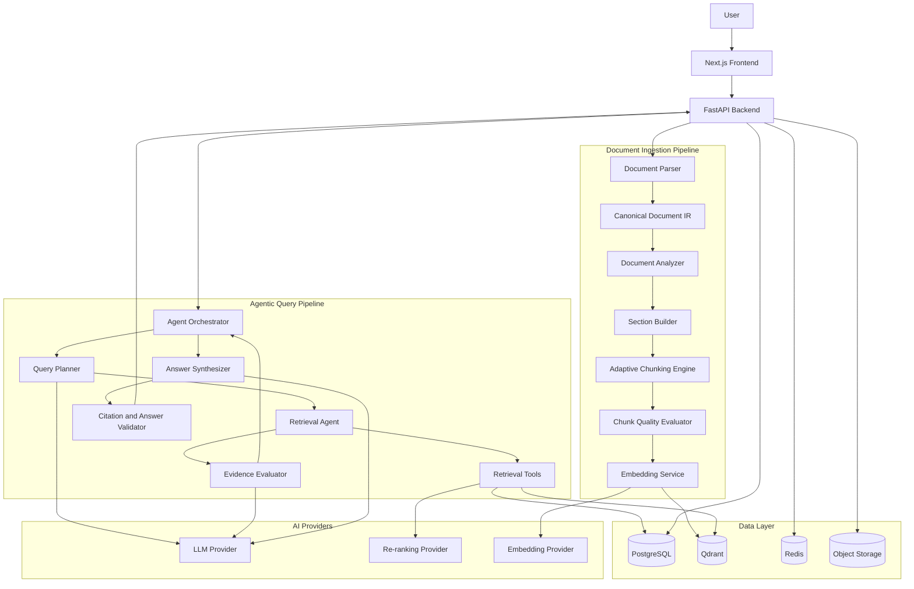
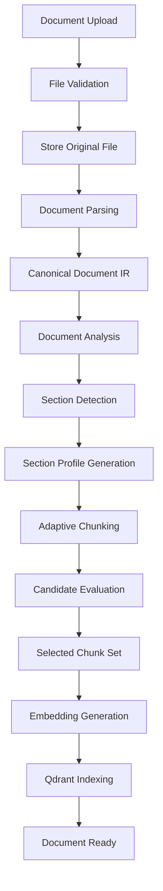
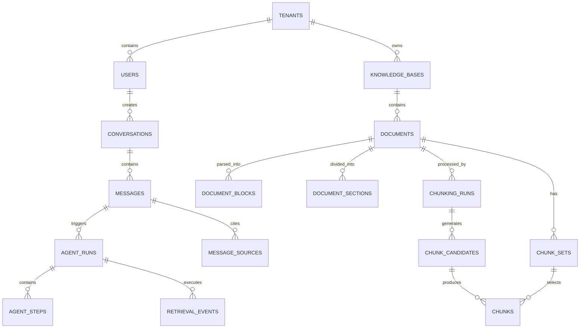
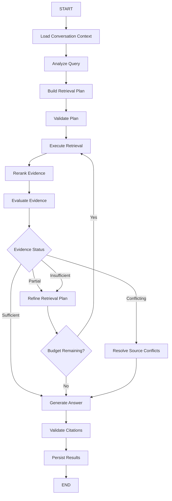

# Technical Proposal
# Agentic RAG — Adaptive Document Intelligence & Question Answering System

**Version:** 1.1  
**Date:** November 2026  
**Status:** Proposed Architecture  
**Primary Language:** Python  
**Architecture Style:** Modular Monolith + Agentic Workflow  
**Target Application:** Document-based AI Chatbot  
**Changelog:** v1.1 — added conversation context resolution, document quality assessment, retrieval-tier chunking evaluation, document relationship metadata, and a consolidated versioning snapshot.

---

# 1. Executive Summary

## 1.1. Project Overview

The proposed system is an extensible Agentic Retrieval-Augmented Generation (Agentic RAG) platform that enables users to upload documents, manage a predefined knowledge base, and interact with an AI assistant capable of answering questions based on available knowledge.

Unlike traditional RAG systems that execute a fixed retrieval pipeline, this system introduces an agentic orchestration layer that can dynamically determine how to retrieve, evaluate, and synthesize information.

The system is designed to:

- Understand document structures and content characteristics.
- Adaptively process documents using multiple chunking strategies.
- Select appropriate retrieval strategies based on user queries.
- Decompose complex questions into smaller retrieval tasks.
- Perform iterative retrieval when initial evidence is insufficient.
- Evaluate retrieved evidence before generating answers.
- Produce context-aware responses with verifiable citations.
- Maintain conversational context across multiple turns.

The architecture prioritizes modularity, observability, reliability, and extensibility.

## 1.2. Core Design Principles

1. **Agentic, but controlled:** Agents operate within explicit workflows, tool permissions, iteration limits, and execution policies.
2. **Adaptive processing:** Document ingestion and query retrieval adapt to document characteristics and question requirements.
3. **Evidence-driven generation:** Answers must be grounded in retrieved evidence.
4. **Modular architecture:** LLM providers, embedding models, vector databases, chunking strategies, and retrieval methods must be replaceable.
5. **Reproducibility:** Agent decisions, retrieval operations, and document processing configurations must be recorded.
6. **Security by design:** Document permissions must be enforced during retrieval, not after evidence has been exposed to the LLM.
7. **Incremental extensibility:** The initial implementation should support future advanced retrieval, reranking, multimodal documents, and specialized agents without requiring architectural redesign.

---

# 2. Scope and Requirements

## 2.1. Functional Requirements

### Document Management

- Upload PDF and TXT documents.
- Support predefined knowledge bases.
- Manage document lifecycle and processing status.
- Extract document content and structural information.
- Assess extraction quality and flag documents that need OCR or manual review.
- Process documents asynchronously.
- Reprocess documents when parsing or chunking configurations change.
- Track document versions and processing history.

### Conversational Interface

- Multi-turn conversations.
- Streaming responses.
- Conversation history.
- Context-aware follow-up questions.
- Source citations in generated answers.
- Appropriate no-answer behavior when evidence is insufficient.

### Agentic Retrieval

- Query classification and intent detection.
- Dynamic retrieval planning.
- Dense vector search.
- Sparse or keyword search.
- Hybrid retrieval.
- Metadata-filtered retrieval.
- Query rewriting.
- Query decomposition.
- Context expansion.
- Reranking.
- Evidence sufficiency evaluation.
- Iterative retrieval.
- Citation validation.

### Adaptive Document Processing

- Multiple chunking strategies.
- Document and section analysis.
- Section-level strategy selection.
- Multiple candidate generation.
- Chunk quality evaluation.
- Candidate selection.
- Versioned chunk sets.

## 2.2. Non-functional Requirements

- Modular and maintainable codebase.
- Asynchronous document ingestion.
- Scalable retrieval and indexing.
- Configurable LLM and embedding providers.
- Secure multi-user document access.
- Structured logs and traces.
- Retry and failure isolation.
- Deterministic workflow constraints.
- Automated testing and retrieval evaluation.

## 2.3. Initial Scope

The initial release focuses on text-based PDF and TXT documents.

The following capabilities are not mandatory for the first release:

- OCR for scanned documents.
- Advanced image and chart understanding.
- Audio/video ingestion.
- Autonomous web browsing.
- External system actions.
- Fully autonomous multi-agent collaboration.
- Knowledge graph construction.

These capabilities can be introduced as independent extensions.

---

# 3. High-Level System Architecture

The system consists of two primary execution pipelines:

1. **Document Ingestion Pipeline:** Understands and processes documents before they become searchable.
2. **Agentic Query Pipeline:** Plans and executes retrieval operations when users ask questions.

The two pipelines share document representations, retrieval interfaces, metadata, and observability infrastructure.

## 3.1. Architecture Diagram



## 3.2. Technology Stack

| Component | Proposed Technology | Responsibility |
|---|---|---|
| Frontend | Next.js + TypeScript | Chat UI, uploads, sources |
| Backend | Python + FastAPI | REST API and orchestration |
| Agent Workflow | LangGraph | Stateful agentic workflow |
| LLM | OpenAI / Anthropic | Planning, evaluation, generation |
| Embeddings | OpenAI Embeddings | Vector representations |
| Vector Database | Qdrant | Dense and sparse retrieval |
| Metadata Database | PostgreSQL | Users, documents, conversations, chunks |
| Background Jobs | Redis + RQ | Asynchronous ingestion |
| Object Storage | S3-compatible storage | Original documents and artifacts |
| PDF Parser | PyMuPDF | PDF extraction |
| Reranking | Provider abstraction | Relevance ranking |
| Observability | Langfuse | Traces, prompts, token usage, evaluations |
| Deployment | Docker Compose | Initial deployment |

All provider integrations must be implemented behind internal interfaces.

The application must not depend directly on a particular LLM vendor or vector database implementation.

---

# 4. Document Ingestion Pipeline

## 4.1. Overview

Document ingestion is responsible for transforming uploaded files into structured, searchable knowledge.

Unlike traditional RAG ingestion, the proposed system includes adaptive document analysis and chunking.



## 4.2. Document Parser

The parser extracts document content and converts it into a normalized representation.

Supported input formats:

- PDF
- TXT
- Markdown

Potential future extensions:

- DOCX
- HTML
- CSV
- XLSX

The parser must preserve:

- Original text.
- Reading order.
- Page numbers.
- Heading information.
- Paragraph boundaries.
- Lists.
- Tables.
- Code blocks.
- Source coordinates when available.

## 4.3. Canonical Document IR

All chunking strategies operate on the same canonical document representation.

Example:

```python
@dataclass
class DocumentBlock:
    id: str
    block_type: str
    content: str
    order: int

    page_start: int | None
    page_end: int | None

    heading_path: list[str]
    metadata: dict


@dataclass
class DocumentSection:
    id: str
    document_id: str

    title: str | None
    heading_path: list[str]

    blocks: list[DocumentBlock]

    section_type: str
    metadata: dict
```

The IR is persisted independently from chunking artifacts.

This allows the system to experiment with new chunking strategies without parsing the original document again.

## 4.4. Document Analyzer

The analyzer identifies document characteristics.

Examples:

- Document type.
- Language.
- Structural complexity.
- Content distribution.
- Presence of tables and code.
- Heading hierarchy.
- Extraction quality.
- Estimated token count.

The analyzer combines deterministic detectors and optional LLM-based analysis.

The LLM must not be responsible for reconstructing source locations or inventing document structure.

### Document Quality Assessment

Quality assessment runs immediately after parsing, before Section Builder and adaptive chunking. Its purpose is to prevent a well-tuned chunking strategy from operating on badly extracted input.

Output:

```python
class DocumentQualityReport(BaseModel):
    extraction_quality: float
    reading_order_confidence: float
    structure_confidence: float
    table_detection_confidence: float

    warnings: list[str]

    requires_ocr: bool
    requires_manual_review: bool
```

Typical failure modes to detect:

- Two-column layouts with crossed reading order.
- Repeating headers and footers.
- Broken table structures.
- Scanned or image-only pages.
- Lost characters during text extraction.

Gate rules:

- `requires_ocr = true` → the document does not enter adaptive chunking; the status is surfaced to the user.
- `requires_manual_review = true` → the document is marked degraded and processing continues only with an explicit flag.
- Low confidence values are stored on the document and included in observability traces.

The LLM must not silently repair document structure without preserving provenance to the original content.

## 4.5. Section Builder

The document is divided into logical sections before chunking.

Preferred hierarchy:

1. Explicit headings.
2. Numbered sections.
3. Structural boundaries.
4. Paragraph grouping.
5. Semantic boundaries as fallback.

A document may contain multiple section types, and each section can use a different chunking configuration.

---

# 5. Adaptive Hybrid Chunking Engine

## 5.1. Objective

The Adaptive Hybrid Chunking Engine determines how each section should be segmented into retrieval-friendly chunks.

The engine uses multiple strategies, candidate generation, quality evaluation, and selection policies.

It is an independent subsystem and does not depend on the query-time agent.

## 5.2. Supported Strategies

| Strategy | Primary Use Case |
|---|---|
| Fixed-size | Unstructured text baseline |
| Recursive | General prose |
| Structure-aware | Documents with heading hierarchy |
| Semantic | Long text with frequent topic transitions |
| Markdown-aware | Markdown and technical documentation |
| Table-aware | Tables and structured data |
| Code-aware | Source code and API examples |
| Q&A-aware | FAQ and question-answer documents |
| Parent-child | Hierarchical retrieval and context expansion |

Parent-child is treated as a chunk representation and retrieval relationship rather than merely another splitting algorithm.

## 5.3. Strategy Selection

The selection process combines:

- Rule-based candidate generation.
- LLM-based strategy recommendation.
- Strategy compatibility validation.
- Candidate execution.
- Chunk quality evaluation.
- Cost-aware ranking.

Example:

```text
Section: API Reference

Profile:
  Paragraph: 40%
  Table: 35%
  Code: 25%

Generated candidates:
  1. Structure-aware
  2. Structure-aware + Table-aware + Code-aware
  3. Recursive

LLM recommendation:
  1. Composite strategy
  2. Structure-aware
  3. Recursive

Evaluation:
  Composite: 0.93
  Structure-aware: 0.87
  Recursive: 0.72

Selected:
  Composite
```

Scores are illustrative and must be calibrated against real documents.

Selection operates per section, but a selected strategy may be a composite that applies different splitters by block type — for example recursive for prose, table-aware for tables, code-aware for code blocks. Strategy choice is therefore a per-block mapping inside a section, not a single global algorithm.

## 5.4. Quality Evaluation

The evaluator uses three categories.

### Structural Quality

- Block integrity.
- Heading preservation.
- Source coverage.
- Duplicate detection.
- Page provenance.

### Semantic Quality

- Intrachunk cohesion.
- Context completeness.
- Topic consistency.
- Reference completeness.

### Operational Quality

- Token compliance.
- Chunk count.
- Execution latency.
- Processing cost.

### Retrieval Quality (offline benchmark)

Structural and semantic scores are proxies. The final arbiter is whether the chunks actually improve retrieval.

- Recall@K, MRR and nDCG@K measured on the evaluation dataset (Section 14.2).
- Context precision and context recall.
- Citation accuracy on questions that reference the section.

Example (illustrative numbers only):

| Strategy | Recall@5 | MRR | Citation accuracy |
|---|---:|---:|---:|
| Recursive | 0.72 | 0.68 | 0.75 |
| Structure-aware | 0.84 | 0.79 | 0.88 |
| Semantic | 0.81 | 0.75 | 0.85 |

This tier runs offline against a fixed benchmark, not per request. Its results calibrate the selection policy and the rule-based candidate generator. A strategy must never be promoted on LLM self-assessment alone.

The selection process follows a constraint-first policy:

1. Reject candidates violating hard constraints.
2. Rank eligible candidates by quality.
3. Prefer lower-cost candidates when quality is comparable.
4. Use a deterministic fallback when no candidate is eligible.

## 5.5. Output

The chunking engine returns a versioned `ChunkSet`.

Each chunk includes:

- Document ID.
- Section ID.
- Chunk ID.
- Parent chunk ID when applicable.
- Content.
- Token count.
- Chunk type.
- Page range.
- Heading path.
- Source block references.
- Strategy name and version.

Only selected chunks are embedded and indexed by default.

---

# 6. Agentic RAG Architecture

This is the primary differentiator of the proposed system.

Traditional RAG executes a relatively fixed pipeline:

```text
Question → Embedding → Vector Search → Context → LLM → Answer
```

Agentic RAG introduces an orchestration layer that determines how to solve each question.

```text
Question
   ↓
Understand Intent
   ↓
Plan Retrieval
   ↓
Execute Retrieval Tools
   ↓
Evaluate Evidence
   ↓
Sufficient?
   ├── Yes → Synthesize Answer
   └── No  → Refine Plan and Retrieve Again
   ↓
Validate Citations
   ↓
Final Answer
```

## 6.1. Agent Design

The system uses a centralized orchestrator with specialized workflow nodes.

It does not require a collection of independently communicating autonomous agents.

| Component | Responsibility |
|---|---|
| Agent Orchestrator | Controls workflow state and transitions |
| Query Analyzer | Understands intent and complexity |
| Query Planner | Creates a retrieval plan |
| Retrieval Executor | Executes approved retrieval operations |
| Evidence Evaluator | Determines whether evidence is sufficient |
| Answer Synthesizer | Generates grounded answers |
| Citation Validator | Verifies source references |

This design is easier to test, observe, control, and deploy than an unrestricted multi-agent architecture.

## 6.2. Agent Orchestrator

The orchestrator manages the execution graph.

Responsibilities:

- Maintain conversation and workflow state.
- Invoke appropriate workflow nodes.
- Control tool permissions.
- Limit retrieval iterations.
- Handle retries and failures.
- Decide when to stop.
- Route execution to final synthesis.

Proposed implementation: LangGraph.

The workflow graph must be explicit and stateful.

## 6.3. Query Analyzer

The Query Analyzer determines the type and complexity of a user question.

The analyzer operates on a `ResolvedQuery` produced by conversation context resolution (Section 8.2), not on the raw user string.

Supported query categories:

| Query Type | Example | Expected Behavior |
|---|---|---|
| Simple fact lookup | What is the refund period? | Direct retrieval |
| Conditional | When is a refund allowed? | Retrieve relevant policy clauses |
| Multi-hop | How does feature A affect process B? | Decompose and retrieve |
| Comparison | Compare plans A and B | Retrieve multiple evidence groups |
| Summarization | Summarize this document | Retrieve section-level information |
| Follow-up | What about the second condition? | Resolve conversational context |
| No-answer | What is the CEO's birthday? | Abstain if unsupported |

The analyzer should also identify:

- Required document scope.
- Relevant entities.
- Time constraints.
- Required evidence granularity.
- Whether conversation history is necessary.

## 6.4. Query Planner

The planner creates a structured retrieval plan.

Example:

```json
{
  "query_type": "multi_hop",
  "complexity": "high",
  "retrieval_tasks": [
    {
      "task_id": "task_1",
      "query": "Find the authentication requirements",
      "retrieval_strategy": "hybrid"
    },
    {
      "task_id": "task_2",
      "query": "Find the token expiration policy",
      "retrieval_strategy": "hybrid"
    }
  ],
  "requires_reranking": true,
  "requires_context_expansion": true,
  "max_iterations": 3
}
```

The planner may select among predefined retrieval strategies.

It cannot invent tools, bypass authorization, or execute arbitrary code.

## 6.5. Retrieval Executor

The executor invokes the tools defined by the retrieval subsystem.

The retrieval executor supports:

- Dense vector search.
- Sparse vector search.
- Hybrid search.
- Metadata-filtered search.
- Query rewriting.
- Multi-query retrieval.
- Parent context expansion.
- Neighboring chunk retrieval.
- Document outline retrieval.
- Reranking.

The retrieval method depends on the query plan.

### Retrieval Strategy Examples

| Situation | Retrieval Method |
|---|---|
| General semantic question | Dense search |
| Exact identifier or technical term | Sparse or keyword search |
| Mixed natural language and exact terms | Hybrid search |
| Complex question | Query decomposition |
| Missing surrounding context | Parent/neighbor expansion |
| Large candidate set | Reranking |
| Comparison across documents | Parallel scoped retrieval |

## 6.6. Evidence Evaluator

The Evidence Evaluator determines whether retrieved evidence can answer the original question.

It evaluates:

- Relevance.
- Coverage.
- Source quality.
- Evidence completeness.
- Contradictions.
- Missing information.

Possible outcomes:

```text
SUFFICIENT
PARTIALLY_SUFFICIENT
INSUFFICIENT
CONFLICTING
```

The evaluator can request another retrieval operation when evidence is incomplete.

It must not create new facts or treat its own assumptions as evidence.

## 6.7. Iterative Retrieval

The system supports bounded retrieval loops.

Example:

```text
User:
What are the requirements for receiving a refund,
and how does the exception policy apply?

Iteration 1:
  Retrieve refund policy.
  Retrieve exception policy.

Evidence Evaluation:
  Refund requirements found.
  Exception policy partially found.

Iteration 2:
  Rewrite query to target exception conditions.
  Retrieve related section and parent context.

Evidence Evaluation:
  Sufficient evidence found.

Final:
  Generate answer with citations.
```

Recommended initial limits:

- Maximum retrieval iterations: 3.
- Maximum query decomposition tasks: 5.
- Maximum retrieval candidates per task: configurable.
- Maximum evidence context tokens: configurable.
- Maximum workflow execution time: configurable.

The system should stop early when sufficient evidence is available.

## 6.8. Answer Synthesizer

The synthesizer receives:

- Original user question.
- Relevant conversation context.
- Retrieved evidence.
- Evidence metadata.
- Citation references.
- Response constraints.

It produces an answer grounded in the supplied evidence.

Requirements:

- Do not fabricate unsupported facts.
- Distinguish facts from inference.
- Explain conflicting sources when relevant.
- Cite supporting evidence.
- Explicitly state when information is unavailable.
- Avoid exposing internal planning details unnecessarily.

## 6.9. Citation Validator

The citation validator is a deterministic backend component.

The LLM cannot invent source IDs or page numbers.

Every citation must resolve to a retrieved chunk and its original document provenance.

Validation includes:

- Chunk ID exists.
- Chunk belongs to the current authorized document scope.
- Page reference matches stored metadata.
- Citation is associated with evidence actually supplied to the synthesizer.
- The referenced chunk belongs to the active chunk set.

Invalid citations must be rejected or regenerated.

---

# 7. Retrieval Tools

The agent interacts with the retrieval system through a controlled tool interface.

## 7.1. Proposed Tools

| Tool | Description |
|---|---|
| `dense_search` | Semantic vector retrieval |
| `sparse_search` | Keyword-oriented retrieval |
| `hybrid_search` | Combined dense and sparse retrieval |
| `rerank_results` | Reorder retrieved candidates |
| `get_chunk` | Retrieve original chunk content |
| `get_parent_context` | Expand child chunks to parent context |
| `get_adjacent_chunks` | Retrieve neighboring chunks |
| `get_document_outline` | Retrieve document hierarchy |
| `search_document` | Search within a specific document |
| `search_knowledge_base` | Search within an authorized knowledge base |

## 7.2. Tool Contract

All tools must use structured inputs and outputs.

Example:

```python
class RetrievalRequest(BaseModel):
    query: str
    tenant_id: str
    knowledge_base_ids: list[str]
    document_ids: list[str] = []

    top_k: int = 10
    filters: dict = {}


class RetrievedEvidence(BaseModel):
    chunk_id: str
    document_id: str

    content: str

    score: float

    page_start: int | None
    page_end: int | None

    heading_path: list[str]

    metadata: dict
```

Authorization context must be injected by the backend, not trusted from LLM-generated arguments.

---

# 8. Conversation and Memory Management

## 8.1. Conversation State

The system maintains conversation history in PostgreSQL.

Each turn stores:

- User message.
- Assistant response.
- Referenced documents.
- Retrieved evidence IDs.
- Workflow execution ID.
- Token usage.
- Model information.

## 8.2. Short-term Conversational Context

The current conversation context is used to resolve follow-up questions.

Example:

```text
User:
What is the refund period?

Assistant:
The refund period is 30 days.

User:
What about exceptions?

Agent:
Understands that "exceptions" refers to refund exceptions
and retrieves the relevant policy section.
```

The system should use structured conversation state rather than blindly sending the entire conversation history to every LLM call.

Follow-up resolution must produce a structured result, not merely a rewritten string:

```python
class ResolvedQuery(BaseModel):
    original_query: str
    standalone_query: str
    intent: str
    entities: list[str]
    constraints: dict

    conversation_context: str | None
    is_follow_up: bool
```

Responsibilities of conversation context resolution:

- Resolve pronouns and references across turns.
- Rewrite the query against conversation history.
- Decide whether the turn is a new question or a follow-up.
- Extract constraints carried over from previous turns.
- Preserve user intent and important conditions.

The `ResolvedQuery` is the input to the Query Analyzer (Section 6.3) and is stored with the agent run for reproducibility.

## 8.3. Long-term Memory

Long-term user memory is not mandatory for the initial release.

If introduced later, it should be a separate subsystem with explicit retention, access control, and deletion policies.

Conversation history and document knowledge must not be conflated.

---

# 9. Data Model

PostgreSQL is the source of truth for application and document metadata.

Qdrant stores vector representations and retrieval payloads.

## 9.1. Core Entities

| Entity | Responsibility |
|---|---|
| users | User accounts |
| tenants | Tenant boundaries |
| knowledge_bases | Knowledge base metadata |
| knowledge_base_members | Access permissions |
| documents | Uploaded document metadata |
| document_blocks | Canonical document IR |
| document_sections | Section hierarchy |
| chunking_runs | Document processing executions |
| chunk_candidates | Candidate chunk sets |
| chunks | Chunk content and provenance |
| chunk_sets | Selected chunk versions |
| conversations | Conversation metadata |
| messages | User and assistant messages |
| agent_runs | Agent workflow executions |
| agent_steps | Individual workflow steps |
| retrieval_events | Retrieval operations |
| message_sources | Citation mappings |
| indexing_runs | Embedding and vector indexing status |

## 9.2. Important Relationships



## 9.3. Agent Run Schema

```sql
CREATE TABLE agent_runs (
    id UUID PRIMARY KEY,

    conversation_id UUID NOT NULL REFERENCES conversations(id),
    user_message_id UUID NOT NULL REFERENCES messages(id),

    status VARCHAR(30) NOT NULL,

    workflow_version VARCHAR(50) NOT NULL,

    model_provider VARCHAR(50),
    model_name VARCHAR(100),

    input_tokens INT DEFAULT 0,
    output_tokens INT DEFAULT 0,

    started_at TIMESTAMPTZ,
    completed_at TIMESTAMPTZ,

    error JSONB,

    created_at TIMESTAMPTZ DEFAULT NOW()
);
```

## 9.4. Agent Step Schema

```sql
CREATE TABLE agent_steps (
    id UUID PRIMARY KEY,

    agent_run_id UUID NOT NULL REFERENCES agent_runs(id),

    step_index INT NOT NULL,
    node_name VARCHAR(100) NOT NULL,

    input JSONB,
    output JSONB,

    status VARCHAR(30) NOT NULL,

    model_provider VARCHAR(50),
    model_name VARCHAR(100),

    execution_time_ms BIGINT,

    created_at TIMESTAMPTZ DEFAULT NOW()
);
```

Sensitive content should not be stored in traces by default. Observability must support redaction and retention policies.

## 9.5. Qdrant Payload

Each indexed chunk contains:

```json
{
  "chunk_id": "uuid",
  "document_id": "uuid",
  "chunk_set_id": "uuid",
  "section_id": "uuid",

  "tenant_id": "tenant-001",
  "knowledge_base_id": "kb-001",

  "page_start": 12,
  "page_end": 13,

  "heading_path": [
    "API Reference",
    "Authentication"
  ],

  "chunk_type": "text",
  "strategy": "structure_aware",

  "active": true
}
```

The active chunk set must be versioned.

The system must not delete the currently active index before a new indexing version is ready.

## 9.6. Document Relationship Metadata

Documents commonly reference, supersede or complement each other. The MVP models this as metadata on `documents`, not as a knowledge graph.

| Field | Purpose |
|---|---|
| related_document_ids | Documents explicitly linked as related |
| references | Documents this one cites or depends on |
| supersedes | Older versions this document replaces |
| document_version | Version label within a document family |
| effective_from | Date the document takes effect |
| effective_until | Date the document expires |

Relationship traversal beyond direct metadata lookup — for example multi-hop policy resolution across a document family — is a later extension. Knowledge graph construction remains out of scope (Section 2.3).

## 9.7. Versioning Snapshot

Every run must record the versions that produced its results:

| Component | Versioned as |
|---|---|
| Prompt | Prompt name + version |
| LLM | Provider + model name |
| Embedding | Model + dimension |
| Reranker | Model version |
| Chunking | Strategy name + config version |
| Retrieval | Retrieval configuration version |
| Agent workflow | Workflow version |

`agent_runs` already stores workflow and model versions (Section 9.3). The same snapshot rule applies to `chunking_runs` and `indexing_runs`. A result must be reproducible from its recorded versions; a result that cannot be reproduced is an observability defect.

---

# 10. Agent Workflow State

The agentic workflow should use a strongly typed state object.

Example:

```python
class AgentState(TypedDict):

    run_id: str

    user_id: str
    tenant_id: str

    conversation_id: str
    user_query: str

    conversation_context: list[dict]

    query_analysis: dict
    retrieval_plan: dict

    retrieval_results: list[dict]
    evidence_groups: list[dict]

    evidence_status: str

    iteration_count: int

    final_answer: str | None
    citations: list[dict]

    errors: list[dict]
```

The state must carry authorization context, execution budgets, and iteration limits.

It should not carry unrestricted credentials or provider secrets.

## 10.1. LangGraph Workflow



The workflow must include explicit termination conditions.

A failed retrieval operation must not automatically trigger unlimited agent retries.

---

# 11. Retrieval and Ranking Architecture

## 11.1. Hybrid Retrieval

The initial retrieval layer supports:

- Dense vector retrieval.
- Sparse retrieval.
- Hybrid retrieval.

Dense retrieval captures semantic similarity.

Sparse retrieval improves exact-term matching, especially for:

- Product identifiers.
- API names.
- Error codes.
- Technical terms.
- Document-specific terminology.

The two result sets are combined using a configurable fusion method such as Reciprocal Rank Fusion (RRF).

## 11.2. Retrieval Pipeline

```text
Query
  ↓
Query Normalization
  ↓
Dense Search ──────┐
                   ├── Result Fusion
Sparse Search ─────┘
  ↓
Metadata Filtering
  ↓
Deduplication
  ↓
Reranking
  ↓
Context Expansion
  ↓
Evidence Evaluation
```

The query planner decides which retrieval components are needed.

## 11.3. Retrieval Configuration

Initial configurable parameters:

| Parameter | Initial Value |
|---|---:|
| Dense top-K | 20 |
| Sparse top-K | 20 |
| Fused candidates | 20–30 |
| Reranked top-K | 5–10 |
| Max retrieval iterations | 3 |
| Max decomposition tasks | 5 |

These values are starting points, not universal defaults. They must be tuned against the evaluation dataset.

---

# 12. API Design

## 12.1. Document APIs

| Method | Endpoint | Description |
|---|---|---|
| POST | `/api/v1/documents` | Upload document |
| GET | `/api/v1/documents` | List documents |
| GET | `/api/v1/documents/{id}` | Get document |
| DELETE | `/api/v1/documents/{id}` | Delete document |
| POST | `/api/v1/documents/{id}/process` | Trigger processing |
| GET | `/api/v1/documents/{id}/processing` | Processing status |
| POST | `/api/v1/documents/{id}/reprocess` | Reprocess document |

## 12.2. Conversation APIs

| Method | Endpoint | Description |
|---|---|---|
| POST | `/api/v1/conversations` | Create conversation |
| GET | `/api/v1/conversations` | List conversations |
| GET | `/api/v1/conversations/{id}` | Conversation detail |
| DELETE | `/api/v1/conversations/{id}` | Delete conversation |
| GET | `/api/v1/conversations/{id}/messages` | Message history |

## 12.3. Chat API

```http
POST /api/v1/conversations/{id}/chat
Content-Type: application/json
```

Request:

```json
{
  "message": "What are the refund conditions?",
  "knowledge_base_ids": ["kb-001"],
  "stream": true
}
```

The backend resolves authorized knowledge bases and documents from the authenticated user's permissions.

The client must not be allowed to expand its own authorization scope by supplying arbitrary document IDs.

## 12.4. Streaming Response

Use Server-Sent Events (SSE).

Suggested events:

```text
event: run_started
data: {"run_id": "..."}

event: status
data: {"stage": "query_analysis"}

event: status
data: {"stage": "retrieval"}

event: status
data: {"stage": "evidence_evaluation"}

event: token
data: {"content": "The refund period..."}

event: citation
data: {"chunk_id": "...", "document_id": "..."}

event: completed
data: {"message_id": "..."}
```

Internal reasoning traces and private chain-of-thought must never be streamed to the client.

Only user-safe status messages and validated outputs should be exposed.

---

# 13. Security and Reliability

## 13.1. Authorization

Document authorization must be enforced before retrieval.

Recommended approach:

1. Authenticate user.
2. Resolve tenant and knowledge-base permissions in PostgreSQL.
3. Derive authorized retrieval scope.
4. Pass server-generated filters to Qdrant.
5. Verify retrieved document ownership before returning content.
6. Validate citations against the authorized scope.

Never trust LLM-generated authorization filters.

## 13.2. Prompt Injection

Uploaded documents and retrieved chunks are untrusted data.

The system must:

- Treat retrieved text as evidence, not instructions.
- Prevent document content from modifying system policies.
- Restrict tool execution to registered tools.
- Validate all tool arguments.
- Never allow arbitrary code execution.
- Keep secrets outside agent context.
- Apply output validation.

## 13.3. Reliability

- Background processing with retry.
- Idempotent ingestion jobs.
- Bounded agent loops.
- Provider timeouts.
- Retry with exponential backoff where appropriate.
- Separate ingestion and query execution.
- Independent embedding and indexing retries.
- Versioned indexing.
- Graceful fallback when LLM planning fails.

## 13.4. Data Lifecycle

Deleting a document must trigger cleanup of:

- Original object storage file.
- Canonical IR.
- Chunking artifacts.
- Active and obsolete chunk sets.
- Qdrant points.
- Associated document references.

The operation must be idempotent and auditable.

---

# 14. Observability and Evaluation

Agentic RAG requires more than ordinary application logging.

The system must make it possible to understand why an answer was produced and which retrieval operations contributed to it.

## 14.1. Observability

Langfuse is proposed for:

- LLM traces.
- Prompt versioning.
- Model usage.
- Token consumption.
- Retrieval latency.
- Agent step latency.
- Tool invocation tracking.
- Evaluation scores.
- Failure analysis.

Each request should have a trace containing:

```text
Chat Request
 └── Agent Run
      ├── Query Analysis
      ├── Retrieval Planning
      ├── Dense Search
      ├── Sparse Search
      ├── Reranking
      ├── Evidence Evaluation
      ├── Additional Retrieval
      ├── Answer Generation
      └── Citation Validation
```

## 14.2. Evaluation Dataset

Build a fixed dataset containing:

- Simple factual questions.
- Conditional questions.
- Multi-hop questions.
- Comparison questions.
- Follow-up questions.
- Table-related questions.
- No-answer questions.
- Conflicting-source questions.

Each question should have expected answers and ground-truth source references.

## 14.3. Metrics

### Retrieval

- Recall@K.
- MRR.
- nDCG@K.
- Retrieval precision.

### Generation

- Answer correctness.
- Faithfulness.
- Citation accuracy.
- Context relevance.
- Abstention correctness.

### Agentic Workflow

- Retrieval iterations per query.
- Tool success rate.
- Planner accuracy.
- Evidence sufficiency accuracy.
- Agent completion rate.
- Unnecessary retrieval rate.

### Operations

- End-to-end latency.
- LLM calls per request.
- Token consumption.
- Cost per answer.
- Ingestion latency.
- Indexing failures.

## 14.4. Baseline Comparison

The Agentic RAG implementation must be compared against a Traditional RAG baseline.

| Configuration | Purpose |
|---|---|
| Traditional dense RAG | Baseline |
| Hybrid RAG | Measure lexical retrieval improvement |
| Hybrid RAG + reranking | Measure ranking improvement |
| Agentic RAG | Measure planning and iterative retrieval improvement |

The system should not assume Agentic RAG is automatically better for every query.

Simple questions should use a fast path whenever possible.

---

# 15. Performance and Cost Optimization

## 15.1. Query Complexity Routing

Not every question requires an agentic loop.

The system should classify requests into execution modes:

| Mode | Behavior |
|---|---|
| Fast | One retrieval pass and answer |
| Standard | Hybrid retrieval, reranking, evidence check |
| Agentic | Planning, decomposition, iterative retrieval |

This prevents simple factual questions from incurring unnecessary LLM calls.

## 15.2. Model Routing

Use different model profiles for different tasks:

| Task | Model Requirement |
|---|---|
| Query classification | Small, fast model |
| Query planning | Capable instruction-following model |
| Query rewriting | Small or medium model |
| Evidence evaluation | Medium model |
| Answer synthesis | High-quality generation model |
| Embedding | Dedicated embedding model |
| Reranking | Dedicated reranker |

Model selection must remain configurable.

## 15.3. Caching

Potential cache layers:

- Document parsing cache.
- Embedding cache.
- Query embedding cache.
- Retrieval result cache.
- Document outline cache.

Cache keys must include relevant document versions, active chunk-set versions, model versions, and authorization scope.

Do not reuse cached retrieval results across users or tenants without verifying the same permissions.

---

# 16. Deployment Architecture

## 16.1. Initial Deployment

Docker Compose is sufficient for the initial release.

```text
Deployment
│
├── frontend
│   └── Next.js
│
├── backend
│   └── FastAPI
│
├── ingestion-worker
│   └── Redis RQ Worker
│
├── scheduler (optional)
│
├── postgres
│
├── qdrant
│
├── redis
│
└── object-storage
```

The backend and worker share the same core application packages but run as separate processes.

## 16.2. Scaling Strategy

Potential future deployment:

- Multiple FastAPI instances.
- Multiple ingestion workers.
- Dedicated agent execution workers.
- PostgreSQL connection pooling.
- Qdrant replication and sharding.
- External object storage.
- Distributed tracing.
- Kubernetes deployment.

The initial design should not require Kubernetes.

---

# 17. Project Structure

Proposed Python package layout:

```text
app/
├── api/
│   └── v1/
│       ├── documents.py
│       ├── conversations.py
│       └── chat.py
│
├── domain/
│   ├── documents/
│   ├── conversations/
│   ├── retrieval/
│   └── agents/
│
├── ingestion/
│   ├── parsers/
│   ├── ir/
│   ├── analyzer/
│   ├── section_builder/
│   ├── chunking/
│   │   ├── strategies/
│   │   ├── selection/
│   │   └── evaluation/
│   ├── embedding/
│   └── indexing/
│
├── agentic_rag/
│   ├── graph/
│   │   ├── state.py
│   │   ├── workflow.py
│   │   └── nodes/
│   │
│   ├── planning/
│   ├── retrieval/
│   ├── evaluation/
│   ├── synthesis/
│   └── validation/
│
├── infrastructure/
│   ├── llm/
│   ├── embeddings/
│   ├── vectorstores/
│   ├── database/
│   ├── storage/
│   └── observability/
│
├── services/
│   ├── document_service.py
│   ├── conversation_service.py
│   └── chat_service.py
│
├── workers/
│   └── ingestion_worker.py
│
└── config/
```

Core business logic must remain independent of external provider SDKs.

---

# 18. Implementation Roadmap

The project should be delivered incrementally.

## Phase 1 — Foundation

**Objectives:**

- Project setup.
- PostgreSQL schema.
- Authentication and authorization.
- Document upload.
- Object storage.
- PDF/TXT parsing.
- Canonical Document IR.
- Document quality assessment.
- Document relationship metadata.
- Background processing.

**Deliverable:** Documents can be uploaded, parsed, stored, and tracked.

## Phase 2 — Adaptive Chunking

**Objectives:**

- Section Builder.
- Section Analyzer.
- Strategy Registry.
- Recursive strategy.
- Structure-aware strategy.
- Table-aware strategy.
- Candidate generation.
- Structural quality evaluation.
- Selected ChunkSet persistence.

**Deliverable:** Documents are processed using adaptive section-level chunking.

## Phase 3 — Traditional and Hybrid RAG

**Objectives:**

- Embedding integration.
- Qdrant indexing.
- Dense retrieval.
- Sparse retrieval.
- Hybrid search.
- Reranking.
- Citation mapping.
- Basic answer generation.
- Retrieval metrics and baseline runs for offline comparison.

**Deliverable:** A working RAG chatbot with verifiable citations.

## Phase 4 — Agentic Workflow

**Objectives:**

- LangGraph integration.
- Query Analyzer.
- Query Planner.
- Retrieval tools.
- Evidence Evaluator.
- Query rewriting.
- Query decomposition.
- Bounded iterative retrieval.
- Answer synthesis.
- Citation validation.

**Deliverable:** Agentic RAG with controlled planning and iterative retrieval.

## Phase 5 — Conversation and Production Hardening

**Objectives:**

- Conversation context and follow-up resolution (ResolvedQuery).
- Streaming responses.
- Error handling.
- Retry and timeout policies.
- Prompt injection defenses.
- Observability.
- Evaluation dataset.
- Chunking strategy calibration against the evaluation dataset.
- Performance optimization.
- Deployment documentation.

**Deliverable:** Production-oriented application with monitoring and operational controls.

---

# 19. Acceptance Criteria

The initial release is considered complete when the following conditions are satisfied.

## Document Processing

- Users can upload PDF and TXT files.
- Documents are processed asynchronously.
- Processing status is visible.
- Documents are converted into canonical IR.
- Low-quality extractions are flagged by document quality assessment before chunking.
- Sections are identified.
- Multiple chunking strategies can be executed.
- Candidate quality reports are generated.
- Selected chunks are indexed in Qdrant.
- Failed processing can be retried.

## Agentic RAG

- Users can ask questions about authorized documents.
- The system can use dense and hybrid retrieval.
- Complex questions can be decomposed.
- The system can execute bounded iterative retrieval.
- Evidence sufficiency is evaluated.
- Answers include validated citations.
- Unsupported questions produce an appropriate abstention.
- Follow-up questions are resolved into a structured `ResolvedQuery` and use conversational context.

## Security

- Users cannot retrieve documents outside their permissions.
- Retrieved document content is treated as untrusted input.
- LLMs cannot bypass backend authorization.
- Tool calls are validated.
- Deleting a document removes its associated retrieval data.

## Observability

- Each chat request has an agent run ID.
- Agent steps and tool invocations are traceable.
- Model usage and execution latency are recorded.
- Failures can be investigated.
- Retrieval quality can be evaluated against a fixed dataset.

---

# 20. Estimated Implementation Effort

The following estimate assumes a small, single-developer implementation with existing API credentials and deployment infrastructure provided.

| Phase | Estimated Effort |
|---|---:|
| Foundation and ingestion | 3–4 days |
| Adaptive chunking | 3–5 days |
| Traditional and hybrid RAG | 3–4 days |
| Agentic workflow | 4–6 days |
| Conversation, observability and hardening | 3–5 days |
| **Total** | **16–24 working days** |

This is an engineering estimate, not a fixed delivery commitment.

The v1.1 additions — conversation context resolution, document quality assessment, retrieval-tier chunking evaluation and document relationship metadata — are expected to fit within the stated ranges, but they push Phase 2 and Phase 5 toward their upper bounds.

The estimate excludes:

- OCR and scanned document processing.
- Complex multi-tenant enterprise authorization.
- Advanced multimodal document understanding.
- Large-scale distributed infrastructure.
- Extensive custom frontend design.
- External integrations beyond the stated scope.

A smaller client-facing MVP can be delivered by limiting the initial strategy set and agentic workflow capabilities.

---

# 21. Future Extensions

The proposed architecture supports several future directions.

### Advanced Document Intelligence

- OCR.
- Multimodal document processing.
- Image and chart understanding.
- Layout-aware parsing.
- Knowledge graph extraction.

### Advanced Agentic Retrieval

- Multi-hop reasoning.
- Cross-document evidence synthesis.
- Contradiction detection.
- Specialized domain retrieval agents.
- Query-specific retrieval policies.

### Adaptive Learning

- Learn strategy preferences from evaluation history.
- Optimize retrieval configurations from feedback.
- Train a routing model from historical decisions.
- Use online feedback to improve retrieval policies.

### Advanced Memory

- Persistent user preferences.
- Knowledge-base-level memory.
- Conversation summarization.
- Cross-session context management.

### Enterprise Capabilities

- Fine-grained document permissions.
- Audit logs.
- SSO.
- Multiple knowledge bases.
- Usage quotas.
- Cost controls.

---

# 22. Final Architecture Decisions

| Area | Decision |
|---|---|
| Architecture | Modular Monolith |
| Backend | Python + FastAPI |
| Agent Orchestration | LangGraph |
| Document Processing | Canonical Document IR |
| Chunking | Adaptive Hybrid Chunking |
| Chunking Granularity | Section-level |
| Candidate Selection | Hybrid adaptive evaluation |
| Retrieval | Dense + Sparse + Hybrid |
| Retrieval Orchestration | Agentic, bounded workflow |
| Evidence Evaluation | Dedicated evaluator |
| Answer Generation | Evidence-grounded synthesis |
| Citation Validation | Deterministic backend validation |
| Metadata Store | PostgreSQL |
| Vector Database | Qdrant |
| Background Jobs | Redis + RQ |
| Object Storage | S3-compatible |
| Observability | Langfuse |
| Initial Deployment | Docker Compose |

---

# 23. Conclusion

This proposal introduces an Agentic RAG platform that goes beyond conventional document retrieval.

Its main capabilities are built around three interconnected intelligence layers:

**1. Document Intelligence**

The system understands document structures and selects appropriate chunking strategies at section level.

**2. Retrieval Intelligence**

The system determines how to retrieve information based on the intent and complexity of each question.

**3. Evidence Intelligence**

The system evaluates retrieved evidence, decides whether more information is needed, and validates the final answer.

The result is a modular, extensible document intelligence platform that can evolve from a lightweight document chatbot into a more sophisticated knowledge assistant.

The architecture intentionally combines deterministic software components with LLM-driven decisions. This provides the flexibility of agentic workflows without sacrificing control, reliability, security, and reproducibility.

**The core principle is simple: the LLM plans and reasons within a controlled system; the backend enforces permissions, validates evidence, and guarantees execution constraints.**